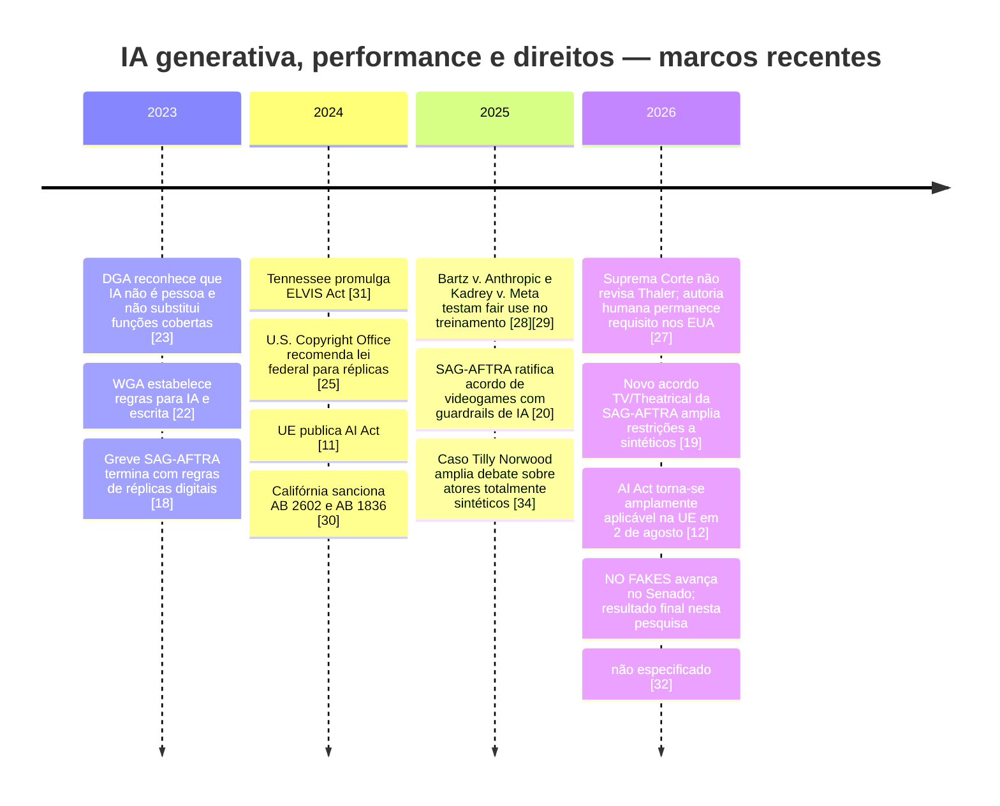

# IA generativa no entretenimento: atores digitais, vozes sintéticas e direitos autorais

## Resumo executivo

A IA generativa está transformando o entretenimento menos por substituir, de uma só vez, atores, roteiristas ou dubladores e mais por **decompor a performance humana em ativos reutilizáveis**: rosto, corpo, movimentos, timbre, prosódia, interpretação, personagem e estilo podem ser capturados, modelados e recombinados. Tecnologias de geração de vídeo, clonagem e conversão de voz, sincronização labial, rejuvenescimento digital e modelos multimodais permitem hoje produzir desde pequenos retoques até “réplicas digitais” identificáveis de uma pessoa e personagens inteiramente sintéticos.[1][2][3] A consequência jurídica é que um único plano audiovisual pode envolver simultaneamente direitos autorais sobre roteiro, música e imagens; direitos conexos do intérprete; direito à imagem, voz e personalidade; proteção de dados; contrato de trabalho ou prestação artística; e regras coletivas sindicais. citeturn17search21

A distinção jurídica mais importante é esta: **direito autoral sobre uma obra não equivale a direito sobre a identidade de uma pessoa**. Uma voz isoladamente não é, em regra, uma “obra” autoral no mesmo sentido de uma música, mas a imitação reconhecível de uma voz pode violar direitos de personalidade, publicity rights ou obrigações contratuais; nos Estados Unidos, *Midler v. Ford Motor Co.* e *Waits v. Frito-Lay* já reconheciam, décadas antes da IA generativa, responsabilidade pela apropriação publicitária de imitações deliberadas de vozes distintivas.[35][36] De modo inverso, obter o consentimento do ator para sua réplica digital não libera automaticamente direitos sobre roteiro, trilha, personagem, gravações de terceiros ou material usado no treinamento do modelo.

No Brasil, a Constituição protege imagem e voz; o Código Civil disciplina direitos da personalidade; a Lei 9.610/1998 protege autores e intérpretes, conferindo aos artistas intérpretes ou executantes poderes sobre fixação, reprodução e outros usos de suas performances e estendendo proteção à reprodução de voz e imagem quando associadas à atuação; e a LGPD pode incidir sobre dados pessoais e biométricos, embora contenha exclusão para tratamentos realizados exclusivamente para fins jornalísticos e artísticos.[5][6][7][8] citeturn5search0turn8view1turn7view0turn9view0turn1search30 A LDA também define autor como pessoa física criadora da obra, o que torna difícil encaixar uma máquina como autora de uma criação puramente autônoma; o grau mínimo de contribuição humana necessário para reivindicar proteção em obras produzidas com IA, contudo, **não é especificado expressamente pela legislação brasileira**.[7] citeturn7view0

Nos Estados Unidos, a situação é mais fragmentada. O Copyright Office recomendou uma lei federal específica sobre réplicas digitais por entender insuficiente a combinação existente de copyright, publicity rights estaduais e outras causas de ação.[24][25] citeturn0search4turn0search7 Califórnia e Tennessee já adotaram normas relevantes: AB 2602 e AB 1836 protegem performers vivos e falecidos em relação a réplicas digitais; o ELVIS Act do Tennessee ampliou expressamente a proteção da voz diante de clonagem e IA.[30][31] citeturn16search1turn16search2 O NO FAKES Act avançou por unanimidade no Judiciary Committee do Senado em junho de 2026, mas seu status legislativo final em 10 de outubro de 2026 é **não especificado nas fontes confirmadas nesta pesquisa**.[32] citeturn16search21

Na União Europeia, o regime é mais horizontal. O AI Act tornou-se, em geral, aplicável em 2 de agosto de 2026 e exige, entre outras medidas, marcação detectável de determinados conteúdos sintéticos e divulgação quando um deployer utiliza deepfakes; para obras evidentemente artísticas, criativas, satíricas ou ficcionais, a informação pode ser feita de forma que não prejudique a fruição da obra.[11][12] citeturn13view1turn21search24 Para modelos de IA de propósito geral, o regulamento também exige política de cumprimento do direito autoral europeu, respeito às reservas de direitos de text and data mining e resumo suficientemente detalhado do conteúdo de treinamento.[11][13] citeturn13view0turn12view3

O desenvolvimento talvez mais significativo para produtores não tenha vindo dos parlamentos, mas da **negociação coletiva**. O acordo SAG-AFTRA de 2023 estabeleceu consentimento e especificidade para réplicas digitais, tratamento de performers sintéticos e deveres de negociação; o acordo TV/Theatrical ratificado em junho de 2026 acrescentou restrições ao uso de sintéticos.[18][19] citeturn0search3turn20view5 O acordo de videogames de 2025 exige consentimento e disclosure e permite suspender consentimento para geração de novo material durante greve.[20] citeturn20view4 A Equity britânica, por sua vez, recomenda cautela com escaneamentos e cláusulas de IA e defende remuneração proporcional, negociação coletiva e criação de direitos de personalidade mais claros sobre voz, rosto e corpo.[16][17] citeturn20view1turn20view2

A recomendação central para o setor é, portanto, não tratar “autorização para IA” como uma cláusula genérica. O padrão mais defensável é um sistema de **consentimento granular + remuneração por escopo + rastreabilidade técnica + cadeia de direitos documentada**. O produtor deve conseguir responder, para cada ativo sintético: quem é a pessoa representada, quais gravações alimentaram o modelo, quem possui os copyrights correspondentes, para qual projeto e personagem o clone foi autorizado, por quanto tempo, em quais mídias e territórios, se pode haver treinamento futuro, sublicenciamento ou geração em tempo real, quanto será pago e como o consentimento poderá terminar.

## Tecnologias, atores digitais e vozes sintéticas

“Deepfake” tornou-se um rótulo amplo, mas juridicamente convém separar técnicas diferentes. O AI Act europeu define deepfake como conteúdo de imagem, áudio ou vídeo gerado ou manipulado por IA que se assemelha a pessoas, objetos, lugares, entidades ou eventos existentes e que pode falsamente parecer autêntico ou verdadeiro.[11] citeturn12view1 Em produção audiovisual, porém, a mesma família tecnológica pode ser usada legitimamente: rejuvenescimento, substituição facial autorizada, correção de atuação, sincronização labial, dublagem multilíngue ou reconstrução de uma performance incompleta. O risco jurídico decorre muito menos do algoritmo isolado do que de **identificabilidade, consentimento, origem dos dados e finalidade de uso**.

Há três categorias práticas. A primeira é a **réplica digital identificável**: uma representação sintética da aparência, voz ou performance de uma pessoa real. A segunda é o **performer sintético**, personagem humanoide que não pretende representar uma pessoa real específica. A terceira é o **avatar ou personagem digital dirigido por um performer**, no qual a captura humana continua sendo substancial mesmo que o resultado visual seja não humano. Essa taxonomia não é apenas técnica: os contratos SAG-AFTRA distinguem réplicas de performers reais de personagens totalmente sintéticos e estabelecem mecanismos distintos de consentimento, notice e bargaining.[18] citeturn0search3

Na imagem, uma cadeia moderna pode combinar captura fotogramétrica ou escaneamento corporal, modelos de identidade, geração ou transformação quadro a quadro, reenactment facial, lip-sync e composição tradicional de efeitos visuais. Nos sistemas mais recentes, modelos multimodais permitem condicionar resultados por texto, imagens de referência, vídeo e, em certos produtos, áudio, aproximando etapas antes separadas de pré-visualização, VFX e pós-produção.[1] citeturn17search21 Ferramentas e famílias de produtos de geração audiovisual oferecidas por empresas como OpenAI, Google e Runway ilustram essa convergência; como versões e funcionalidades mudam rapidamente, especificações exatas de outubro de 2026 não são tratadas aqui como estáticas.

Na voz há duas arquiteturas especialmente relevantes. Em text-to-speech, o sistema recebe texto e parâmetros ou uma representação de identidade vocal para sintetizar fala; em speech-to-speech ou voice conversion, preserva-se parte da interpretação — ritmo, intenção e inflexões — enquanto se converte a identidade acústica para outra voz. Serviços comerciais como ElevenLabs oferecem clonagem/síntese vocal, enquanto a Respeecher desenvolve tecnologia de transformação de voz dirigida, inclusive para aplicações de mídia.[2][3] A diferença é juridicamente importante: um resultado pode incorporar muito mais da **performance** do ator-condutor do que sugere a expressão “voz gerada por IA”.

Nos videogames e experiências interativas surge uma quarta modalidade: **geração em tempo real**. O acordo SAG-AFTRA de 2025 exige que certas descrições de uso indiquem inclusive se o personagem será utilizado para produzir diálogo gerado em tempo real; o contrato estabelece parâmetros específicos de consentimento e disclosure para réplicas digitais.[20] citeturn20view4 Aqui, um ator deixa de fornecer apenas falas previamente fixadas e potencialmente fornece uma “capacidade performática” reutilizável, o que torna inadequada a lógica contratual de pagar somente pelo tempo de estúdio.

A detecção deve ser entendida em duas camadas. A primeira é **forense**: modelos analisam artefatos de imagem, inconsistências temporais, espectro de áudio, características de locutor ou outros sinais estatísticos para estimar se houve síntese. Essa abordagem é probabilística e pode perder confiabilidade após compressão, reedição ou evolução dos geradores. A segunda é **proveniência**: padrões como C2PA/Content Credentials permitem anexar declarações e histórico de edição autenticados criptograficamente ao conteúdo.[4] Proveniência é geralmente mais útil para uma cadeia profissional de produção porque responde “de onde veio e o que aconteceu com este arquivo?”, mas não transforma automaticamente uma afirmação assinada em verdade.

O legislador europeu já incorporou essa lógica: o artigo 50 do AI Act exige que fornecedores de sistemas que geram conteúdo sintético de áudio, imagem, vídeo ou texto tornem os outputs identificáveis em formato legível por máquina, na medida tecnicamente viável; deployers de deepfakes têm dever próprio de disclosure.[11] citeturn13view1 Para um estúdio, portanto, a estratégia madura não é escolher entre detector **ou** watermark **ou** contrato. É combinar controle de acesso ao modelo, registros de consentimento, provenance metadata, hashes dos ativos-fonte e revisão humana.

## Arquitetura jurídica comparada

No Brasil, a proteção é fragmentada, mas relativamente rica. O artigo 5º da Constituição protege intimidade, vida privada, honra e imagem e também prevê proteção às participações individuais em obras coletivas e à reprodução da imagem e voz humanas.[5] citeturn5search0 Os artigos 11 a 21 do Código Civil tratam dos direitos da personalidade; o artigo 20 permite reagir à divulgação ou uso da imagem em determinadas circunstâncias, inclusive quando destinada a fins comerciais, e prevê tutela após a morte por legitimados indicados na lei.[6] citeturn8view1 Isso não equivale a um monopólio irrestrito sobre toda representação da pessoa: liberdade de expressão, informação, contexto artístico e jurisprudência constitucional precisam ser ponderados.

A Lei 9.610/1998 adiciona uma camada distinta. Autor é definido como a pessoa física criadora de obra literária, artística ou científica; obras protegidas são “criações do espírito”.[7] citeturn7view0 A lei exige autorização prévia e expressa para diversas modalidades de exploração, inclusive reprodução, adaptação, transformação e inclusão em produção audiovisual, e determina interpretação restritiva dos negócios sobre direitos autorais quando o alcance não estiver claramente previsto.[7] citeturn7view0 Para atores e músicos, os artigos 89 a 96 estabelecem direitos conexos: o intérprete pode autorizar ou proibir fixação, reprodução, execução pública, radiodifusão, disponibilização e outros usos, e a proteção alcança a reprodução de sua voz e imagem quando associadas à atuação.[7] citeturn9view0

Isso produz uma consequência operacional crucial. Digitalizar o rosto de um ator para gerar uma nova cena pode envolver **direito de imagem**; usar tomadas da atuação original para construir o modelo pode envolver **direito conexo do intérprete**; copiar frames, trilha ou material audiovisual pode envolver **copyright**; e o contrato pode impor limitações adicionais. A autorização concedida em uma dessas camadas não elimina automaticamente as demais.[5][6][7]

A LGPD acrescenta proteção quando scans faciais, registros vocais ou outros elementos constituem dados pessoais e, em determinadas condições, dados biométricos sensíveis.[8] citeturn1search2 Entretanto, a própria LGPD exclui de seu âmbito tratamentos realizados exclusivamente para fins jornalísticos e artísticos.[8] citeturn1search30 Para uma produtora, não é prudente concluir automaticamente que toda operação ligada a um filme seja “exclusivamente artística”: cadastro de talentos, segurança, autenticação, formação de banco reutilizável de scans e licenciamento comercial podem ter finalidades distintas. Essa é uma avaliação jurídica caso a caso.

O Senado aprovou o PL 2.338/2023, marco regulatório brasileiro de IA, em dezembro de 2024 e o encaminhou à Câmara.[9][10] citeturn2search0turn2search18 O estado final do projeto na Câmara em **10 de outubro de 2026 é não especificado** nas fontes que puderam ser confirmadas nesta pesquisa; por isso, não se deve apresentá-lo como lei vigente.

Nos Estados Unidos, copyright e identidade seguem trilhas diferentes. O U.S. Copyright Office concluiu em seu projeto sobre IA que os problemas de réplicas digitais justificam legislação federal específica e identificou lacunas e inconsistências no sistema atual.[24][25] citeturn0search4turn0search7 Em *Thaler v. Perlmutter*, o D.C. Circuit decidiu em 18 de março de 2025 que a Copyright Act exige autoria humana e confirmou a rejeição do registro de uma obra para a qual uma máquina havia sido indicada como única autora.[26] citeturn22search2 Em 2 de março de 2026, a Suprema Corte recusou revisar o caso, mantendo a decisão inferior.[27] citeturn22news37 Isso não significa que toda obra feita **com auxílio** de IA seja desprotegida; significa que a máquina não pode ser a autora e que a proteção depende da contribuição autoral humana presente no resultado.

A situação do **treinamento** é bem menos resolvida. Em *Bartz v. Anthropic*, decisão de 2025 considerou transformativo e fair use determinado uso de livros para treinamento, mas distinguiu esse uso da manutenção de uma biblioteca obtida por fontes piratas.[28] citeturn22news38 Em *Kadrey v. Meta*, o tribunal também decidiu a favor da Meta quanto aos autores então demandantes, mas enfatizou que isso decorria dos argumentos e da prova apresentados e não estabelecia uma regra geral de que todo treinamento de IA com material protegido é fair use.[29] citeturn22news40 Para produtores, esses casos são sinal de risco, não um “safe harbor” universal.

A Califórnia passou a atacar diretamente réplicas digitais. O governador assinou AB 2602 e AB 1836 em setembro de 2024: a primeira limita determinadas cláusulas contratuais que permitiriam substituir um performer por sua réplica sem descrição razoavelmente específica e adequada representação; a segunda reforça a proteção contra uso não autorizado de réplicas de personalidades falecidas em obras audiovisuais e gravações, com exceções legais.[30][19] citeturn16search1turn20view5 O Tennessee, pelo ELVIS Act, tornou explícita a proteção à voz diante de clonagem e outras utilizações de IA, ampliando seu regime de direitos de personalidade/publicidade.[31] citeturn16search2

Antes da IA, *Midler* e *Waits* já demonstravam a lógica subjacente: uma empresa não obtém necessariamente liberdade para imitar comercialmente uma pessoa apenas porque não copiou uma gravação protegida.[35][36] Esse princípio ajuda a compreender por que “a voz não é protegida por copyright” é uma defesa incompleta para voice cloning.

Na União Europeia, o AI Act trabalha ao lado, e não no lugar, do copyright e do GDPR. Desde 2 de agosto de 2026, a maior parte do regulamento está aplicável.[12] citeturn21search24 Para modelos de propósito geral, fornecedores precisam manter política de cumprimento do copyright e observar reservas de direitos feitas sob o artigo 4º, n.º 3, da Diretiva DSM; também devem publicar resumo suficientemente detalhado do conteúdo utilizado no treinamento.[11] citeturn13view0 A Diretiva DSM permite text and data mining de obras licitamente acessíveis em certas condições, mas o titular pode reservar os direitos, inclusive por meios legíveis por máquina quando o conteúdo está online.[13] citeturn12view3 O GDPR, por sua vez, trata dados biométricos usados para identificação única como categoria especial sujeita a regime reforçado; fotografia, por si só, não se torna automaticamente dado biométrico sensível sem processamento técnico específico para identificação.[14] citeturn12view5

No Reino Unido, a Part II da Copyright, Designs and Patents Act 1988 estabelece direitos de performers sobre gravação e exploração de performances.[15] A dificuldade apontada pela Equity é que o conjunto atual de copyright, performer rights, contrato e data protection não oferece, na visão do sindicato, controle suficientemente claro contra todas as imitações sintéticas; por isso a organização pede um regime mais robusto de personality rights sobre voz, face e corpo.[16][17] citeturn20view1turn20view2 O resultado final de eventuais reformas britânicas específicas de copyright/IA em 10 de outubro de 2026 é **não especificado nesta pesquisa**.

## Contratos, sindicatos e políticas da indústria

Hollywood tornou a IA um tema contratual estrutural em 2023. No acordo SAG-AFTRA TV/Theatrical, a lógica central foi consentimento informado e específico, em vez de uma proibição total. Para determinadas réplicas baseadas no emprego do performer, o consentimento deve ser claro, conspícuo e descrever de modo razoavelmente específico o uso; os termos abrangem voz e aparência.[18] citeturn0search3 O acordo também distingue réplicas de pessoas reais de performers inteiramente sintéticos e prevê notice e oportunidade de negociação sindical para certos usos destes últimos.[18] citeturn0search3

Essa arquitetura foi reforçada: em junho de 2026, membros da SAG-AFTRA ratificaram novo TV/Theatrical Agreement que, segundo o próprio sindicato, preserva e amplia as proteções anteriores e adiciona restrições ao uso de sintéticos para substituir trabalho humano.[19] citeturn20view5 O significado industrial é importante: para uma produção signatária, autorização genérica num release individual pode ser insuficiente mesmo que, isoladamente, pareça válida segundo direito contratual comum.

Na animação, o acordo ratificado em 2024 definiu voice actors como humanos, adaptou as regras de réplicas digitais às particularidades de vozes de personagens e tornou necessário consentimento em determinadas situações nas quais um sistema generativo é provocado com o nome do performer; a utilização de voz sintética pode desencadear notice e bargaining.[21] citeturn0search8 No acordo de videogames ratificado em julho de 2025, a SAG-AFTRA obteve consentimento e disclosure para réplicas e a possibilidade de performers suspenderem consentimento para geração de novo material durante greve.[20] citeturn20view4

A disputa de videogames mostra que o problema não termina no consentimento da celebridade cuja identidade está sendo recriada. Em maio de 2025, a SAG-AFTRA apresentou uma unfair-labor-practice charge contra a Llama Productions, ligada à Epic Games, a respeito da utilização de IA para a voz de Darth Vader em *Fortnite*, alegando falta de notice e bargaining sobre a substituição de atores.[19][33] citeturn20view5turn19news35 Assim, podem coexistir autorização de propriedade intelectual/personality rights de um lado e obrigações trabalhistas coletivas de outro.

Para roteiristas, o WGA estabeleceu uma lógica diferente: IA não é “writer”; material produzido por IA não recebe o mesmo tratamento de literary material ou source material escrito por humanos para reduzir direitos do roteirista; e o guild mantém sua posição sobre utilização de obras de escritores no treinamento de sistemas.[22] O WGA também vem atuando legislativamente em matéria de transparência de datasets e copyright.[22] citeturn20view0 Em 2023, a DGA obteve reconhecimento contratual de que IA não é uma pessoa e que IA generativa não pode substituir as funções atribuídas a membros da guilda naquele acordo.[23] citeturn20view3

No Reino Unido, a Equity adota uma posição particularmente útil para desenho contratual. Seu AI Toolkit inclui orientação específica sobre scanning de aparência, captura de voz e cláusulas de IA, inclusive a campanha “Don’t Sign On Set”, que procura impedir que consentimentos amplos sejam obtidos do performer no momento de maior assimetria operacional.[16] citeturn20view1 Seu AI Vision Statement rejeita economicamente a ideia de que um pagamento único necessariamente remunere de maneira justa uma réplica utilizável indefinidamente em milhares de projetos e defende pagamento proporcional ao alcance e duração da exploração, além de negociação coletiva.[17] citeturn20view2

Na prática, esses acordos revelam uma mudança de paradigma: o objeto econômico já não é somente “uma diária de atuação” ou “uma sessão de voz”, mas potencialmente um **modelo capaz de gerar performances futuras**. A licença, portanto, precisa tratar captura, treinamento, criação da réplica e cada categoria de exploração como etapas distintas.

## Casos práticos e cronologia

Um caso histórico ajuda a compreender o presente. Em *Midler v. Ford Motor Co.*, a cantora Bette Midler recusou participar de uma campanha; uma imitadora foi usada para produzir voz intencionalmente semelhante, e o Ninth Circuit reconheceu que uma voz distintiva pode funcionar como atributo de identidade apropriável mesmo quando a gravação original não é copiada.[35] Em *Waits v. Frito-Lay*, a imitação deliberada da voz de Tom Waits em publicidade também gerou responsabilidade.[36] A IA torna essa velha questão exponencialmente mais barata e escalável.

No outro extremo está o “ator sintético”. Em 2025, a personagem Tilly Norwood — apresentada como atriz gerada por IA — provocou reação da SAG-AFTRA e da Equity; os sindicatos relacionaram o episódio a riscos de treinamento não consentido, competição com performers humanos e ausência de personality rights suficientemente claros.[19][34] citeturn19news37turn19news34 O ponto jurídico não é que toda personagem sintética seja ilícita: um personagem genuinamente novo pode não incorporar a identidade de nenhuma pessoa específica. O problema surge quando a aparência, voz ou performance é suficientemente derivada ou identificável para acionar direitos de pessoas reais, ou quando os dados de treinamento foram utilizados em desconformidade com copyright, contrato ou proteção de dados.

A cronologia abaixo sintetiza a rápida passagem de conflito trabalhista para regulação:

Os eventos e datas da linha do tempo são documentados pelas guildas, governos, tribunais e instituições indicados nas respectivas referências.[18][19][20][22][23][25][27][28][29][30][31][32][34] citeturn0search3turn20view5turn20view4turn20view0turn20view3turn0search7turn22news37turn22news38turn22news40turn16search1turn16search2turn16search21

## Impactos econômicos, criativos e éticos

A principal vantagem econômica da IA no entretenimento é reduzir o custo marginal de **variações**: novas línguas, falas adicionais, versões de publicidade, sincronização labial, pickups, alterações de idade e, potencialmente, diálogo dinâmico. O benefício pode ser grande em conteúdo com longa vida econômica, porque uma única captura pode sustentar numerosas versões. É precisamente essa reutilização que explica por que SAG-AFTRA e Equity rejeitam consentimento indeterminado e remuneração puramente baseada na sessão original.[17][18][20] citeturn20view2turn0search3turn20view4

Mas parte da economia obtida em produção migra para custos de governança: clearance, armazenamento seguro de scans, gerenciamento de versões do modelo, auditoria, contratação especializada e eventual litígio. Um clone que economiza uma nova sessão de gravação pode criar um passivo muito maior caso a empresa não consiga provar a origem dos dados, o escopo da autorização ou qual versão do modelo gerou determinada fala. Isso faz da **proveniência jurídica** um componente da infraestrutura de produção, não apenas uma função do departamento jurídico.

Criativamente, os usos menos controversos tendem a ser os que preservam a agência do performer: correções, acessibilidade, dublagem aprovada, envelhecimento/rejuvenescimento, preservação de uma performance e geração controlada a partir de instruções do próprio artista. Já os usos que transformam uma atuação finita em uma fonte aberta de performances futuras mudam a natureza do contrato. O acordo de videogames da SAG-AFTRA reconhece explicitamente essa diferença ao tratar diálogo gerado em tempo real como informação material para a decisão do performer.[20] citeturn20view4

Existe ainda uma questão de **substituição coletiva**. Uma estrela pode negociar um valor elevado pela licença de sua réplica, enquanto figurantes, dubladores, locutores e performers menos conhecidos enfrentam maior pressão para aceitar buyouts amplos. O receio não é apenas hipotético no debate trabalhista: as sucessivas negociações da SAG-AFTRA sobre cinema, animação, gravações e videogames tornaram consentimento, remuneração e substituição por sintéticos temas centrais.[19][20][21] citeturn20view5turn20view4turn0search8 A Equity também alerta que mudanças tecnológicas podem agravar desigualdades de acesso ao trabalho e diferenças de renda se adotadas sem governança inclusiva.[17] citeturn20view2

Eticamente, o núcleo é **autonomia identitária**. Um performer não está necessariamente licenciando apenas um arquivo: ao entregar voz, rosto e movimentos suficientes para treinamento, pode estar permitindo que terceiros fabriquem algo que o público perceberá como uma nova atuação sua. Consentir com um scan para um personagem de fantasia não significa, eticamente, consentir com propaganda política, conteúdo sexual, violência extrema ou falas incompatíveis com sua reputação. É por isso que os contratos sindicais norte-americanos passaram a exigir descrições razoavelmente específicas de uso, e não simples autorizações do tipo “qualquer uso, em qualquer mídia, perpetuamente”.[18][20] citeturn0search3turn20view4

O problema sobrevive à morte. A Califórnia disciplinou réplicas digitais de personalidades falecidas por AB 1836, enquanto a legislação brasileira combina tutela post mortem da personalidade com direitos conexos de duração legal determinada.[6][7][30] citeturn8view1turn9view0turn16search1 A melhor prática não é presumir que herdeiros podem simplesmente “autorizar tudo”, mas mapear separadamente sucessão de publicity/personality rights, copyrights, direitos conexos, contratos anteriores e direitos sobre arquivos utilizados para construir o modelo.

## Recomendações práticas

**Para produtores**, o primeiro passo deve ser um *AI rights inventory*. Antes de gerar qualquer réplica, a produção deve separar pelo menos cinco perguntas: quem controla a identidade; quem controla as gravações usadas como input; quem possui a performance fixada; qual contrato coletivo se aplica; e se o tratamento de dados está juridicamente coberto. No Brasil, isso significa analisar conjuntamente Constituição, Código Civil, LDA, contratos e, quando aplicável, LGPD.[5][6][7][8] Nos Estados Unidos, a análise ainda precisa ser estadual — especialmente Califórnia e Tennessee — além de federal e sindical.[24][30][31] citeturn5search0turn8view1turn9view0turn1search30turn16search1turn16search2

A cláusula contratual deve distinguir **captura**, **criação da réplica**, **treinamento/fine-tuning** e **uso do output**. Deve identificar projeto e personagem; usos previstos; mídia; território; prazo; possibilidade de geração de falas não gravadas; usos em publicidade; sublicenciamento; armazenamento; segurança; reutilização em sequências; treinamento de modelos gerais; geração em tempo real; remuneração; créditos; procedimento de aprovação quando pertinente; destino do modelo ao término; e regime após a morte. O parâmetro de “descrição razoavelmente específica” encontrado nos acordos SAG-AFTRA e na legislação californiana fornece um bom ponto de referência mesmo para produções fora dos Estados Unidos.[18][20][30] citeturn0search3turn20view4turn16search1

O estúdio deve igualmente manter um **registro técnico-jurídico por ativo**: identificação do performer, documentos de consentimento, fontes de treinamento, versão do modelo, fornecedor, data de geração, prompts ou parâmetros relevantes, arquivos-fonte autorizados e histórico de edição. Content Credentials/C2PA podem complementar esse sistema ao preservar afirmações criptograficamente verificáveis sobre proveniência.[4] Na União Europeia, mecanismos desse gênero tornam-se ainda mais relevantes devido às obrigações de identificação de conteúdo sintético do AI Act.[11] citeturn13view1

**Para atores, dubladores e músicos**, a principal recomendação é não negociar “IA” como uma autorização única. Uma licença para reproduzir a performance originalmente gravada é economicamente diferente de uma licença para gerar novas falas; uma licença para um filme é diferente de treinamento de um modelo fundacional; e uso de um personagem específico é diferente de permitir que o timbre seja disponibilizado para múltiplos anunciantes. A posição da Equity contra consentimentos improvisados durante a filmagem e sua defesa de remuneração proporcional à escala e duração do uso são boas referências contratuais.[16][17] citeturn20view1turn20view2

Também é recomendável negociar direito de receber informação sobre usos subsequentes, auditoria quando tecnicamente possível, proibição de categorias reputacionalmente sensíveis, segurança dos dados biométricos e procedimento de término. Para artistas com identidade de alto valor comercial, planejamento sucessório deve tratar explicitamente voz, imagem, arquivos de captura e poderes para autorizar — ou recusar — réplicas post mortem.

**Para legisladores**, o desafio é evitar dois extremos: uma regra tão fraca que uma pessoa perca o controle econômico sobre seu rosto ou voz, e uma propriedade tão absoluta sobre “semelhança” que inviabilize biografias, sátira, crítica, documentários, jornalismo e liberdade artística. A recomendação do U.S. Copyright Office por legislação específica para digital replicas parte precisamente da percepção de que copyright, publicity rights e outras normas não resolvem uniformemente o problema.[25] citeturn0search7 Modelos como o AI Act europeu demonstram outra dimensão útil: transparência pode coexistir com exceções e modalidades especiais para expressão artística.[11] citeturn13view1

Para o Brasil, uma futura lei de IA deveria preservar claramente a autonomia da Lei de Direitos Autorais e dos direitos da personalidade, esclarecer o regime de réplicas identificáveis e treinamento, proteger consentimento específico e negociação coletiva e evitar a ficção de que “ter copyright” equivale a “ter direito sobre uma pessoa”. O melhor marco regulatório será aquele que diferenciar **obra, performance, identidade, dado e modelo**. A tecnologia os mistura; o direito precisa separá-los antes de autorizar sua recombinação.

## Referências

[1] Google Cloud. **O que é inteligência artificial (IA)?**  
https://cloud.google.com/learn/what-is-artificial-intelligence?hl=pt-BR

[2] ElevenLabs. **Voice Cloning**.  
https://elevenlabs.io/voice-cloning

[3] Respeecher. **Voice Cloning and Speech-to-Speech Technology**.  
https://www.respeecher.com/

[4] Coalition for Content Provenance and Authenticity — C2PA. **Specifications**.  
https://c2pa.org/specifications/

[5] Brasil. **Constituição da República Federativa do Brasil de 1988**.  
https://www.planalto.gov.br/ccivil_03/constituicao/constituicao.htm

[6] Brasil. **Lei nº 10.406, de 10 de janeiro de 2002 — Código Civil**.  
https://www.planalto.gov.br/ccivil_03/leis/2002/l10406compilada.htm

[7] Brasil. **Lei nº 9.610, de 19 de fevereiro de 1998 — Lei de Direitos Autorais**.  
https://www.planalto.gov.br/ccivil_03/leis/l9610.htm

[8] Brasil. **Lei nº 13.709, de 14 de agosto de 2018 — Lei Geral de Proteção de Dados Pessoais**.  
https://www.planalto.gov.br/ccivil_03/_ato2015-2018/2018/lei/l13709compilado.htm

[9] Senado Federal. **Projeto de Lei nº 2.338, de 2023 — Marco Legal da Inteligência Artificial**.  
https://www25.senado.leg.br/web/atividade/materias/-/materia/157233

[10] Senado Federal. **Marco da inteligência artificial é aprovado em Plenário e vai à Câmara**.  
https://www12.senado.leg.br/noticias/videos/2024/12/marco-da-inteligencia-artificial-e-aprovado-em-plenario-e-vai-a-camara

[11] União Europeia. **Regulation (EU) 2024/1689 — Artificial Intelligence Act**.  
https://eur-lex.europa.eu/eli/reg/2024/1689/oj/eng

[12] European Commission. **AI Act — Regulatory framework and application timeline**.  
https://digital-strategy.ec.europa.eu/en/policies/regulatory-framework-ai

[13] União Europeia. **Directive (EU) 2019/790 on Copyright and Related Rights in the Digital Single Market**.  
https://eur-lex.europa.eu/eli/dir/2019/790/oj/eng

[14] União Europeia. **Regulation (EU) 2016/679 — General Data Protection Regulation (GDPR)**.  
https://eur-lex.europa.eu/eli/reg/2016/679/oj/eng

[15] Reino Unido. **Copyright, Designs and Patents Act 1988 — Part II: Rights in Performances**.  
https://www.legislation.gov.uk/ukpga/1988/48/part/II

[16] Equity. **Equity AI Toolkit**.  
https://www.equity.org.uk/advice-and-support/know-your-rights/ai-toolkit

[17] Equity. **Equity’s AI Vision Statement**.  
https://www.equity.org.uk/advice-and-support/know-your-rights/ai-toolkit/equitys-ai-vision-statement

[18] SAG-AFTRA. **2023 TV/Theatrical Contracts — Artificial Intelligence Resources**.  
https://www.sagaftra.org/contracts-industry-resources/contracts/2023-tvtheatrical-contracts/artificial-intelligence-resources

[19] SAG-AFTRA. **Artificial Intelligence — Member Resources and chronology of AI protections**.  
https://www.sagaftra.org/contracts-industry-resources/member-resources/artificial-intelligence

[20] SAG-AFTRA. **2025 Interactive Media Video Game Agreement**.  
https://www.sagaftra.org/contracts-industry-resources/interactive/2025-interactive-media-video-game-agreement

[21] SAG-AFTRA. **TV Animation Agreements**.  
https://www.sagaftra.org/contracts-industry-resources/television/tv-animation-agreements

[22] Writers Guild of America West. **Artificial Intelligence — Know Your Rights**.  
https://www.wga.org/contracts/know-your-rights/artificial-intelligence

[23] Directors Guild of America. **DGA Tentative Agreement Achieves Historic Breakthroughs on Key Global, Economic, Creative Rights, and Safety Issues**.  
https://www.dga.org/News/PressReleases/2023/230603-DGA-and-AMPTP-Reach-Tentative-Agreement

[24] U.S. Copyright Office. **Copyright and Artificial Intelligence**.  
https://copyright.gov/ai/

[25] U.S. Copyright Office. **Copyright Office Releases Part 1 of Artificial Intelligence Report, Recommends Federal Digital Replica Law**.  
https://copyright.gov/newsnet/2024/1048.html

[26] United States Court of Appeals for the District of Columbia Circuit, reprodução em Justia. **Thaler v. Perlmutter, No. 23-5233 (D.C. Cir. 2025)**.  
https://law.justia.com/cases/federal/appellate-courts/cadc/23-5233/23-5233-2025-03-18.html

[27] Reuters. **U.S. Supreme Court declines to hear dispute over copyrights for AI-generated material**.  
https://www.reuters.com/legal/government/us-supreme-court-declines-hear-dispute-over-copyrights-ai-generated-material-2026-03-02/

[28] The Guardian. **Anthropic did not breach copyright when training AI on books without permission, court rules**.  
https://www.theguardian.com/technology/2025/jun/25/anthropic-did-not-breach-copyright-when-training-ai-on-books-without-permission-court-rules

[29] Associated Press. **Judge dismisses authors’ copyright lawsuit against Meta over AI training**.  
https://apnews.com/article/e77968015b94fbbf38234e3178ede578

[30] Office of Governor Gavin Newsom. **Governor Newsom signs bills to protect digital likeness of performers**.  
https://www.gov.ca.gov/2024/09/17/governor-newsom-signs-bills-to-protect-digital-likeness-of-performers/

[31] State of Tennessee, Office of the Governor. **Gov. Lee Signs ELVIS Act Into Law**.  
https://www.tn.gov/governor/news/2024/3/21/photos--gov--lee-signs-elvis-act-into-law.html

[32] U.S. House of Representatives, Office of Rep. María Elvira Salazar. **NO FAKES Act Advances Out of Senate Judiciary Committee Unanimously**.  
https://salazar.house.gov/media/press-releases/rep-salazars-no-fakes-act-advances-out-senate-judiciary-committee-unanimous

[33] Associated Press. **SAG-AFTRA files unfair labor practice charge over use of AI to make Darth Vader’s voice in Fortnite**.  
https://apnews.com/article/627d9adac6d4007b3bc489e511c1beb8

[34] The Guardian. **Equity threatens mass direct action over use of actors’ images in AI content**.  
https://www.theguardian.com/technology/2025/oct/13/equity-threatens-mass-direct-action-over-use-of-actors-images-in-ai-content

[35] United States Court of Appeals for the Ninth Circuit, reprodução em Justia. **Midler v. Ford Motor Co., 849 F.2d 460 (9th Cir. 1988)**.  
https://law.justia.com/cases/federal/appellate-courts/F2/849/460/37285/

[36] United States Court of Appeals for the Ninth Circuit, reprodução em Justia. **Waits v. Frito-Lay, Inc., 978 F.2d 1093 (9th Cir. 1992)**.  
https://law.justia.com/cases/federal/appellate-courts/F2/978/1093/184793/