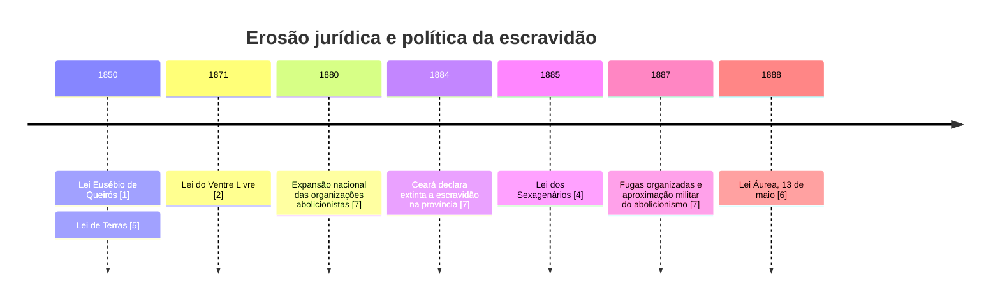

# Abolição da escravidão no Brasil em 1888: antecedentes, processo e consequências

## Resumo executivo

A abolição legal da escravidão no Brasil, consumada pela Lei nº 3.353 de 13 de maio de 1888, foi o desfecho de um processo longo, conflitivo e não linear, no qual se combinaram transformações econômicas, pressão internacional, mudanças legislativas graduais, mobilização política abolicionista e, sobretudo nas décadas finais do cativeiro, formas cada vez mais intensas de resistência dos próprios escravizados.[6][7] A interpretação tradicional que reduzia o episódio ao gesto humanitário da princesa Isabel é insuficiente, assim como seria reducionista explicá-lo exclusivamente pelo avanço do capitalismo ou apenas pela resistência escrava: a historiografia contemporânea tende a enfatizar a interação entre economia, instituições, movimentos sociais, conflitos raciais e agência dos cativos.[7]

A Lei Eusébio de Queirós, de 1850, reprimiu juridicamente o tráfico transatlântico de africanos escravizados, inserindo-se em uma conjuntura de crescente pressão britânica e de progressivo isolamento internacional do escravismo brasileiro.[1][8] No mesmo ano, a Lei de Terras determinou, como regra, a compra como via de aquisição das terras públicas devolutas, criando um regime fundiário que, embora não mencionasse raça, teria profunda importância para compreender as dificuldades posteriores de acesso à propriedade por trabalhadores pobres, libertos e seus descendentes.[5] A Lei do Ventre Livre, de 1871, declarou livres os filhos de mulheres escravizadas nascidos desde sua promulgação, mas manteve mecanismos que preservavam por muitos anos o controle senhorial sobre essas crianças; a regulamentação subsequente instituiu matrículas e procedimentos administrativos para a nova situação jurídica.[2][3] A Lei dos Sexagenários, de 1885, concedeu liberdade aos maiores de sessenta anos sob condições que incluíam, em diversos casos, prestação adicional de serviços, exemplificando os limites do gradualismo imperial.[4][13]

Na economia, a expansão cafeeira do Sudeste tornou a questão do trabalho particularmente decisiva, enquanto o açúcar permaneceu importante no Nordeste e economias pecuárias regionais combinaram de maneiras distintas trabalhadores escravizados, livres, agregados e dependentes.[7][12] A supressão do tráfico africano não produziu imediatamente trabalho livre generalizado: favoreceu também a redistribuição interna da população escravizada e ocorreu paralelamente à experimentação de diferentes regimes de contratação, parceria, colonato e imigração.[8][12] Por isso, é inadequado imaginar uma substituição súbita, em 1888, de “escravidão” por “trabalho assalariado”; a transformação do mercado de trabalho atravessou décadas e variou significativamente entre regiões.[7][12]

A mobilização abolicionista também atingiu escala nacional muito antes da assinatura da Lei Áurea: Angela Alonso identificou 1.446 eventos de protesto entre 1868 e 1888, 293 associações especificamente abolicionistas, cerca de 600 manifestações públicas e atividades distribuídas por 236 cidades de todas as províncias do Império.[7] Joaquim Nabuco destacou-se na arena parlamentar e internacional, José do Patrocínio na imprensa, nas conferências e nas campanhas populares, Luiz Gama na ação judicial, André Rebouças na articulação política, e Antônio Bento nas redes de fugas organizadas.[7] No final de 1887, o alinhamento de setores militares à causa abolicionista enfraqueceu decisivamente a capacidade estatal de obrigar o Exército a participar da repressão às fugas.[7]

A Lei Áurea foi deliberadamente curtíssima: seu artigo primeiro extinguiu a escravidão a partir da data da lei e seu artigo segundo revogou as disposições contrárias.[6] Não instituiu reforma agrária, educação, crédito, habitação, indenização ou programa trabalhista para os libertos, tampouco indenizou os antigos proprietários no próprio diploma.[6] A consequência foi uma ruptura jurídica monumental sem uma ruptura equivalente nas estruturas de acesso à riqueza, à terra e ao poder.[5][7] A persistência dessas assimetrias não significa que a emancipação tenha sido inútil — a liberdade jurídica alterou profundamente relações familiares, mobilidade, contratos e capacidade de ação dos antigos cativos —, mas significa que cidadania formal e igualdade substantiva não foram produzidas simultaneamente.[7][25][26]

No Brasil contemporâneo, desigualdades raciais mensuráveis mostram por que o pós-abolição continua central para interpretar a estrutura social: dados do IBGE indicam persistentes diferenças entre brancos, pretos e pardos em renda, trabalho, educação, saneamento e representação em posições de comando.[14] O Ipea calculou que, em 2022, a renda média das pessoas brancas era 87% superior à das pessoas negras no indicador analisado pela instituição.[15] Políticas como a obrigatoriedade do ensino de História e Cultura Afro-Brasileira e a política federal de cotas — posteriormente revista — representam respostas estatais tardias às desigualdades historicamente acumuladas.[17][18][29]

## Antecedentes jurídicos, internacionais e econômicos

O Brasil foi o principal destino americano do tráfico transatlântico de africanos escravizados, e estimativas difundidas pelas Nações Unidas e pela UNESCO apontam para aproximadamente cinco milhões de africanos desembarcados no território brasileiro ao longo da história do tráfico, dentro de um movimento atlântico que deportou cerca de 12,5 milhões de pessoas.[9] Bases de dados como *Slave Voyages*, construídas a partir de décadas de pesquisa histórica, permitem reconstruir navios, portos, rotas, cronologias e dimensões quantitativas desse sistema atlântico.[10]

A pressão britânica contra o tráfico foi importante, mas não deve ser confundida com uma campanha britânica pela emancipação imediata de todos os escravizados no Brasil.[8] A diplomacia entre Londres e Rio de Janeiro concentrou-se por décadas na supressão do comércio atlântico, em meio a tratados, legislação brasileira pouco aplicada e medidas coercitivas britânicas, tema analisado extensivamente por Leslie Bethell.[8] O resultado de 1850 deve, portanto, ser entendido como produto tanto dessa pressão externa quanto de decisões políticas internas de um Estado imperial que já não conseguia sustentar indefinidamente a entrada clandestina de africanos.[1][8]

A Lei nº 581, de 4 de setembro de 1850, conhecida como Lei Eusébio de Queirós, estabeleceu medidas para reprimir o tráfico de africanos e tratou juridicamente sua importação em termos extremamente severos, constituindo uma virada decisiva na capacidade do governo de atacar o comércio transatlântico.[1] O fim efetivo das grandes entradas africanas não aboliu, entretanto, a instituição escravista: proprietários continuaram podendo comprar, vender e transferir pessoas dentro do território imperial.[1][8] Por isso, a economia escravista adaptou-se, e a demanda das regiões cafeeiras pôde ser parcialmente atendida por deslocamentos internos de cativos vindos de outras áreas.[8][12]

Outra medida de 1850 teve consequências duradouras: a Lei nº 601, a Lei de Terras, estabeleceu que as terras devolutas seriam adquiridas, como regra, por compra, rompendo com formas anteriores de apropriação gratuita de terras públicas.[5] A lei não era um estatuto racial e não proibia nominalmente libertos de possuir terra, mas o estabelecimento de uma barreira monetária à propriedade precisa ser considerado na análise de uma sociedade em que escravizados e a maior parte dos libertos não acumulavam recursos em condições comparáveis às das elites proprietárias.[5][26] A conexão histórica entre abolição e questão fundiária não está, portanto, numa proibição racial literal inscrita em 1850, e sim na desigual distribuição prévia de patrimônio e nas condições concretas de acesso ao mercado de terras.[5][26]

Em 28 de setembro de 1871, a Lei nº 2.040, ou Lei do Ventre Livre, declarou livres os filhos de mulheres escravizadas nascidos desde aquela data e estabeleceu outros mecanismos de emancipação, inclusive fundos e possibilidades de alforria.[2] A liberdade dos chamados “ingênuos”, porém, não correspondia a autonomia infantil imediata: a própria lei organizava a tutela e os serviços que poderiam beneficiar os senhores das mães durante anos.[2] A regulamentação de dezembro de 1871 disciplinou a matrícula de escravizados e das crianças abrangidas pela nova legislação, fazendo do registro administrativo um instrumento central do gradualismo emancipatório.[3]

A Lei nº 3.270, de 28 de setembro de 1885, conhecida como Lei dos Sexagenários ou Saraiva-Cotegipe, representou outro compromisso gradualista.[4] O escravizado que alcançava sessenta anos era declarado livre, mas a lei podia obrigá-lo a prestar serviços ao antigo senhor por três anos, cessando essa obrigação quando completasse sessenta e cinco.[4] Estudos recentes interpretam esse dispositivo menos como simples “etapa inevitável” da libertação e mais como uma tentativa tardia de controlar o ritmo da desmontagem do cativeiro e administrar, em favor da ordem senhorial, a transição para relações pós-escravistas.[13]

Economicamente, o processo não pode ser explicado por uma equação simples segundo a qual a “modernização” teria tornado automaticamente a escravidão inviável.[7][12] A historiografia estruturalista dos anos 1960 e 1970, associada em especial a Emília Viotti da Costa, ressaltou as contradições entre expansão capitalista e trabalho escravo, ao passo que pesquisas posteriores demonstraram que relações escravistas podiam conviver durante bastante tempo com mercados, ferrovias, crédito e atividades comerciais modernas.[7] O café fez do Sudeste a zona economicamente mais sensível à reorganização do trabalho; o açúcar permaneceu decisivo em importantes áreas nordestinas, embora a historiografia registre perda relativa do peso econômico da escravidão em regiões açucareiras; e a pecuária apresentou sistemas laborais mais dispersos e mistos, sem reproduzir uniformemente o padrão das grandes plantations cafeeiras.[7][12]

A transição ao trabalho livre começou, portanto, antes de 1888 e continuou depois dela, envolvendo assalariamento, parceria, colonato, pequenos contratos, trabalho doméstico e diferentes formas de dependência rural.[7][12] A imigração europeia, especialmente associada à expansão cafeeira paulista, passou a ser um componente importante dessa reorganização, mas não deve ser interpretada como simples consequência mecânica da Lei Áurea: políticas de recrutamento de trabalhadores estrangeiros e experiências de trabalho livre já estavam em curso antes da extinção jurídica do cativeiro.[12]

Uma cronologia sintética ajuda a visualizar a sobreposição entre legislação e mobilização, sem sugerir que cada nova lei tenha conduzido automaticamente à seguinte.[1][2][4][6][7]

## Escravizados, resistência e movimento abolicionista

A vida sob a escravidão não se reduzia à condição abstrata de “mão de obra”: tratava-se de um regime jurídico de propriedade sobre pessoas sustentado por coerção física, disciplina cotidiana, possibilidade de separação familiar e restrições de movimento, ao mesmo tempo em que os escravizados construíam famílias, comunidades, redes religiosas, economias próprias e estratégias para ampliar margens de autonomia.[25][26] As condições variavam profundamente entre o trabalho doméstico, as ruas das cidades, portos, oficinas, pequenas propriedades, regiões pecuárias, engenhos de açúcar e fazendas de café.[25][26]

Também é inadequado tratar resistência apenas como grandes rebeliões.[7][25] Quilombos e comunidades de fugitivos constituíram uma tradição secular de contestação, mas a resistência abrangia igualmente fugas individuais, negociações, desaceleração do trabalho, compra de alforrias, preservação de vínculos familiares, ações judiciais e utilização das contradições do próprio sistema jurídico contra os senhores.[7][11][25] Angela Alonso resume a inflexão historiográfica dos anos 1980 observando que pesquisas passaram a revelar uma frequência e variedade de conflitos de escravizados contra senhores, policiais e tribunais muito maiores do que sugeriam narrativas mais antigas.[7]

A Justiça tornou-se uma das arenas dessa disputa, e Luiz Gama ocupa posição particularmente importante por seu ativismo jurídico em favor da liberdade de pessoas ilegalmente escravizadas.[7][11] A historiografia do pós-1970 transformou justamente esse tipo de evidência — processos, cartas, pedidos de alforria, registros policiais e ações de liberdade — em instrumento para reconstruir a agência de escravizados que haviam aparecido nas narrativas anteriores sobretudo como objetos das decisões das elites.[7][11]

Paralelamente, consolidou-se a partir de fins dos anos 1860 um movimento abolicionista público e organizado.[7] Associações antiescravistas existiam antes de 1879, e a mobilização coletiva aumentou na segunda metade da década de 1860, antes mesmo da Lei do Ventre Livre.[7] Entre 1868 e 1888, a pesquisa de Angela Alonso encontrou 1.446 eventos de protesto em 35 jornais de nove províncias, além de 293 associações exclusivamente abolicionistas e cerca de 600 manifestações públicas em 236 cidades.[7] Essa capilaridade fundamenta a interpretação do abolicionismo como o primeiro grande movimento social de alcance nacional do Brasil.[7]

A imprensa, os teatros, clubes, conferências, cafés e associações funcionaram como infraestrutura política do movimento.[7] Como o catolicismo era religião oficial e institucionalmente ligado ao Estado, o abolicionismo brasileiro não seguiu exatamente o modelo das redes religiosas protestantes do ativismo anglo-americano; desenvolveu uma propaganda especialmente intensa em espaços teatrais, jornalísticos e associativos.[7] O movimento também manteve contatos com a British and Foreign Anti-Slavery Society e com abolicionistas franceses e hispânicos, enquanto Joaquim Nabuco buscou aliados no exterior para aumentar a pressão política sobre o Estado imperial.[7]

Os protagonistas não desempenhavam funções idênticas.[7] Joaquim Nabuco fez do Parlamento e das conexões internacionais suas principais arenas; José do Patrocínio atuou intensamente no jornalismo, em conferências e campanhas públicas; Luiz Gama associou propaganda e ação judicial; André Rebouças ligou militantes, elites políticas e redes associativas; e Antônio Bento e seus colaboradores participaram de fugas orientadas em São Paulo.[7] A heterogeneidade do movimento — que reunia negros e brancos, monarquistas e republicanos, parlamentares e militantes sem mandato — é precisamente uma das razões pelas quais não convém atribuir a abolição a uma única liderança.[7]

A mobilização passou por uma radicalização decisiva depois de 1885.[7] Diante da repressão do gabinete Cotegipe e do bloqueio parlamentar, setores abolicionistas intensificaram a desobediência civil e as redes organizadas de fugas, enquanto jornais defendiam abertamente o acolhimento de fugitivos.[7] O Ceará já havia declarado extinta a escravidão na província em março de 1884, mostrando que campanhas locais podiam criar fatos políticos consumados antes da decisão nacional.[7]

Em fins de 1887 ocorreu outra mudança na correlação de forças: segundo Alonso, a aproximação do Exército com o campo abolicionista inviabilizou progressivamente o emprego regular das forças militares para sustentar o sistema por meio da perseguição aos fugitivos.[7] O papel militar deve ser entendido nessa conjuntura de crise e não como autoria isolada da emancipação, assim como o papel de D. Pedro II e da princesa Isabel precisa ser situado dentro da pressão que chegava simultaneamente das ruas, dos cativos, da imprensa, das associações e de parcelas da própria elite política.[7]

## Da crise do escravismo à Lei Áurea

Em 1888, a questão central já não era apenas se a escravidão deveria desaparecer, mas por quanto tempo o Estado ainda conseguiria protegê-la diante de fugas, recusas de cooperação, desgaste da legitimidade senhorial e ampliação dos apoios à emancipação imediata.[7] A historiografia relacional interpreta esse momento como resultado do conflito entre movimento abolicionista, contramovimento escravista e instituições imperiais, e não como execução tranquila de um plano concebido previamente pela Coroa.[7]

O gabinete presidido por João Alfredo Correia de Oliveira conduziu a etapa parlamentar final da abolição, substituindo a política mais repressiva associada ao gabinete Cotegipe.[7][20] O projeto de emancipação imediata e sem cláusula de indenização aos proprietários avançou de maneira excepcionalmente rápida pela Câmara dos Deputados e pelo Senado nos dias que antecederam 13 de maio.[20] Embora ainda existissem votos contrários e defesa dos interesses senhoriais, o equilíbrio parlamentar havia mudado profundamente em comparação com as prolongadas disputas em torno das leis de 1871 e 1885.[7][20]

O ponto mais seguro para entender a votação é observar o contraste entre a longa batalha parlamentar anterior e a simplicidade do texto finalmente aprovado.[6][20] A Assembleia Geral decretou e a princesa imperial regente, agindo em nome de D. Pedro II, sancionou a Lei nº 3.353 em 13 de maio de 1888.[6] Seu artigo primeiro dizia que a escravidão estava extinta no Brasil a partir daquela data, e o segundo revogava as disposições em contrário.[6] Rodrigo Augusto da Silva, ministro ligado à condução legislativa da medida, também aparece no documento promulgado.[6]

A concisão da lei é historicamente eloquente.[6] Ela tornou ilegal a propriedade escravista de seres humanos, mas não regulou salário, moradia, educação, crédito, cidadania eleitoral, acesso à terra ou indenização aos antigos escravizados.[6] Tampouco seu texto estabeleceu indenização geral aos antigos proprietários.[6] Portanto, o 13 de maio foi simultaneamente uma ruptura jurídica absoluta com a instituição escravista e uma solução legislativa extremamente limitada quanto à construção material do pós-emancipação.[6][7]

A princesa Isabel tem, nesse processo, uma função histórica incontornável — era a regente que sancionou a lei —, mas disso não decorre que tenha produzido sozinha as condições de sua aprovação.[6][7] Angela Alonso chama atenção para dois excessos simétricos na memória pública: a antiga narrativa da “Redentora”, que diminuía a mobilização social e a resistência negra, e uma inversão que pode tornar invisível o próprio movimento abolicionista multirracial e nacional ao reduzir toda a história a uma oposição entre Isabel e Zumbi.[7]

O mesmo cuidado cabe em relação a D. Pedro II.[7] Houve participação da Coroa no processamento institucional da questão escravista, mas a historiografia diverge sobre quanto poder explicativo se deve atribuir ao imperador e ao Poder Moderador em comparação com mudanças econômicas, iniciativa parlamentar, mobilização abolicionista e ação dos escravizados.[7] A tese mais convincente não precisa escolher entre “abolição por cima” e “abolição por baixo”: a extinção formal exigiu uma lei estatal, mas o contexto que tornou essa lei politicamente inevitável foi construído por conflitos que escapavam ao controle exclusivo do Estado.[7]

## Liberdade sem igualdade: consequências imediatas e de longo prazo

A transformação mais imediata de 13 de maio foi inequívoca: nenhum senhor podia, juridicamente, continuar reivindicando propriedade sobre outra pessoa com base na escravidão.[6] A liberdade legal ampliou as possibilidades de deslocamento, escolha de empregadores, renegociação das relações de trabalho, reconstrução familiar e recusa de formas de disciplina que haviam pertencido ao regime senhorial.[25][26] Isso não significa que todos os libertos abandonaram as propriedades onde trabalhavam nem que todos se mudaram para cidades; escolhas pós-emancipação variaram segundo região, relações familiares, acesso a trabalho, redes comunitárias e oportunidades disponíveis.[25][26]

O problema fundamental foi que a emancipação civil não foi acompanhada, na Lei Áurea, por recursos materiais para tornar a liberdade economicamente igualitária.[6] Não havia em seus dois artigos distribuição de terras, sistema educacional para ex-escravizados, crédito, moradia ou indenização aos libertos.[6] Inseridos em um país onde a propriedade fundiária estava fortemente concentrada e onde as terras públicas estavam submetidas desde 1850 a regras de aquisição predominantemente monetárias, muitos libertos tiveram de negociar a sobrevivência sem patrimônio equivalente ao dos antigos senhores.[5][6]

Isso ajuda a explicar por que “trabalho livre” não é sinônimo histórico de trabalho plenamente autônomo ou assalariamento moderno.[12][25] No campo, ex-escravizados podiam tornar-se assalariados, parceiros, meeiros, colonos ou trabalhadores residentes submetidos a novas formas de dependência; nas cidades, o serviço doméstico, o trabalho portuário, a construção, ofícios manuais, comércio ambulante e ocupações informais absorviam parcelas da população negra.[25][26] As relações de poder construídas no cativeiro não desapareceram simplesmente porque sua forma jurídica principal foi abolida.[25][26]

Ao mesmo tempo, é incorreto representar libertos apenas como vítimas passivas de uma suposta “desorganização” pós-1888.[7][25] A mesma historiografia que recuperou sua agência durante a escravidão demonstrou que homens e mulheres libertos formularam expectativas próprias de liberdade, escolheram lugares de residência, tentaram preservar famílias, negociaram remuneração e contestaram tentativas de restaurar disciplinamentos típicos do cativeiro.[7][25] O pós-abolição foi, assim, um campo de disputa sobre o significado prático da liberdade, e não um simples vazio entre escravidão e marginalização.[25][26]

A imigração europeia, particularmente em São Paulo, ganhou grande importância na reorganização da cafeicultura e foi estimulada por políticas que buscavam trabalhadores estrangeiros para propriedades agrícolas.[12] A imigração não eliminou o trabalho dos negros livres, mas alterou a competição ocupacional e participou de um processo social no qual projetos de modernização frequentemente se articularam a ideias racializadas de população, civilização e “branqueamento”.[12][26] Por isso, a relação entre imigração e pós-abolição deve ser analisada simultaneamente como questão econômica de mão de obra e como parte da história racial do Estado brasileiro.[12][26]

A urbanização posterior também não pode ser atribuída apenas à abolição, pois industrialização, migrações internas, expansão ferroviária e crescimento das cidades constituíram processos próprios.[12] Contudo, a liberdade de circulação e as estratégias de sobrevivência dos libertos contribuíram para o crescimento e reconfiguração de comunidades negras urbanas, ao mesmo tempo que desigualdade patrimonial, precariedade habitacional e discriminação limitaram suas possibilidades de ascensão.[25][26]

A continuidade das desigualdades não significa uma linha causal simples e inalterada entre 1888 e o presente.[14][15] O Brasil passou por industrialização, urbanização maciça, expansão educacional, legislação trabalhista, democratizações, ditaduras, políticas sociais e profundas mudanças demográficas depois da abolição.[14][15] Ainda assim, indicadores contemporâneos revelam uma notável persistência da desigualdade racial: em 2021, pretos e pardos correspondiam a 53,8% dos trabalhadores, mas ocupavam somente 29,5% dos cargos gerenciais registrados no recorte do IBGE.[14] O Ipea registra, para 2022, renda média das pessoas brancas 87% maior que a das pessoas negras no indicador de renda domiciliar analisado pela instituição.[15]

Esses números não “provam” por si sós que cada desigualdade contemporânea derive diretamente da escravidão, mas são compatíveis com um processo histórico de acumulação desigual de patrimônio, educação, redes sociais, oportunidades de emprego e proteção estatal.[14][15][16] O conceito de racismo estrutural é útil justamente quando descreve disparidades reproduzidas por instituições e práticas sociais para além do preconceito consciente de indivíduos isolados; o projeto Inclua, do Ipea, destaca a acumulação de desvantagens pela população negra e a reprodução de desigualdades raciais na prestação de políticas públicas.[16]

## Historiografia, memória, reparação e legado contemporâneo

Os debates historiográficos sobre a abolição podem ser organizados, com simplificação, em três grandes ênfases que não precisam ser mutuamente excludentes.[7] A primeira, fortalecida a partir dos anos 1960, privilegiou estruturas econômicas e contradições entre capitalismo, escravidão e formação do mercado de trabalho livre, tendo *Da senzala à colônia*, de Emília Viotti da Costa, como obra paradigmática.[7] A segunda, especialmente influente desde os anos 1980, colocou no centro a agência dos escravizados, estudando cotidiano, rebeliões, fugas, processos judiciais, costumes e conflitos com senhores e autoridades.[7] A terceira enfatizou instituições, Parlamento, Coroa e elites políticas, lembrando que a abolição formal acabou sendo realizada por uma lei do Estado imperial.[7]

A oposição “abolição por cima” versus “abolição por baixo” é, assim, mais útil como pergunta historiográfica do que como escolha binária.[7] A assinatura ocorreu “por cima”, no sentido estrito de ser uma decisão legislativa sancionada pela regência imperial; mas a condição política para que o Parlamento adotasse uma abolição imediata foi produzida por mobilização social, resistência de escravizados, fugas em massa, opinião pública e enfraquecimento da disposição estatal de sustentar coercitivamente o cativeiro.[6][7] Da mesma forma, a economia condicionou o processo sem ditar automaticamente sua data: como lembra Alonso, ainda na segunda metade da década de 1880 existiam propostas capazes de prolongar juridicamente a escravidão por décadas, razão pela qual a atuação política não pode ser eliminada da explicação.[7]

Outro debate decisivo é o da continuidade.[7][14] A abolição destruiu uma instituição jurídica fundamental e, por isso, não pode ser descrita como mera “mudança de nome” da escravidão; ao mesmo tempo, não redistribuiu o patrimônio acumulado sob o regime escravista nem eliminou hierarquias raciais produzidas ao longo de séculos.[5][6][14] A interpretação historicamente mais rigorosa mantém as duas proposições: 1888 foi uma ruptura real, mas uma ruptura incompleta como projeto de igualdade social.[6][7][14]

A memória pública também mudou.[7] No centenário da abolição, em 1988, tornou-se especialmente forte a crítica à centralidade simbólica do 13 de Maio e da princesa Isabel, enquanto o 20 de Novembro e Zumbi dos Palmares ganharam destaque como referências de resistência negra.[7] Essa alteração não é apenas uma disputa sobre personagens: expressa a mudança de uma história centrada na concessão estatal da liberdade para outra interessada na conquista da liberdade pelos próprios negros e pelos movimentos sociais.[7]

No plano das políticas públicas, a resposta à desigualdade racial tornou-se muito mais explícita no período democrático recente.[16][17][18] A Lei nº 10.639, de 2003, tornou obrigatório o ensino de História e Cultura Afro-Brasileira no ensino fundamental e médio.[18] A Lei de Cotas de 2012 institucionalizou reservas de vagas em instituições federais de ensino para grupos historicamente sub-representados, política posteriormente atualizada pela Lei nº 14.723, de 2023.[17][29] Essas medidas representam uma passagem importante de um modelo de igualdade apenas formal para políticas que reconhecem desigualdades raciais concretas e procuram corrigi-las por mecanismos afirmativos.[16][17]

A Constituição de 1988, por sua vez, reconheceu no artigo 68 do Ato das Disposições Constitucionais Transitórias a propriedade definitiva das terras ocupadas por remanescentes das comunidades dos quilombos, atribuindo ao Estado a emissão dos títulos correspondentes.[24] Nesse sentido amplo, o debate brasileiro sobre reparação tem abrangido não apenas indenizações, mas também território, memória, educação, ação afirmativa, preservação patrimonial e combate à discriminação.[16][17][18][24] Não existe contradição entre reconhecer o caráter libertador da Lei Áurea e sustentar que ela não resolveu o problema histórico da cidadania negra: a primeira proposição descreve a extinção do estatuto de propriedade sobre pessoas, enquanto a segunda examina como riqueza, poder e oportunidades permaneceram distribuídos de modo profundamente desigual.[6][14][15]

O legado mais importante de 1888, portanto, talvez esteja justamente nessa tensão.[6][7] A emancipação mostrou a capacidade de escravizados, libertos, jornalistas, advogados, trabalhadores, parlamentares, intelectuais e associações de desorganizar politicamente uma instituição que durante séculos fora apresentada como natural e indispensável.[7] O pós-abolição demonstrou, porém, que abolir uma relação jurídica de dominação e construir igualdade social são processos históricos distintos.[6][14][16] É dessa distância entre liberdade formal e igualdade substantiva que derivam tanto parte das disputas contemporâneas sobre racismo estrutural quanto a justificativa histórica das políticas de ação afirmativa.[14][15][16][17]

## Leituras adicionais e arquivos para pesquisa

Para uma interpretação integrada do abolicionismo como movimento político, *O abolicionismo como movimento social*, de Angela Alonso, é uma excelente porta de entrada porque compara diretamente explicações econômicas, institucionais e centradas na agência dos escravizados e reconstrói a dimensão nacional e transnacional da mobilização.[7] A monografia posterior de Alonso, *The Last Abolition: The Brazilian Antislavery Movement, 1868–1888*, oferece em inglês uma versão ampliada da análise do movimento e é particularmente útil para comparações internacionais.[22] *Flores, votos e balas*, da mesma autora, aprofunda a reconstrução da campanha, de suas redes e de sua radicalização.[23]

Para compreender escravizados como sujeitos históricos, e não somente como força de trabalho, *Visões da liberdade*, de Sidney Chalhoub, continua sendo leitura fundamental sobre as últimas décadas da escravidão na Corte.[25] *Das cores do silêncio*, de Hebe Mattos, é particularmente importante para entender as relações entre liberdade, cidadania, raça e mundo rural no século XIX e no pós-emancipação.[26] Para os conflitos judiciais e parlamentares, *Cenas da abolição: escravos e senhores no Parlamento e na Justiça*, de Joseli Nunes Mendonça, oferece uma abordagem diretamente centrada na interação entre escravizados e instituições.[11]

Para o tráfico e a dimensão internacional, o estudo clássico de Leslie Bethell sobre Grã-Bretanha, Brasil e supressão do comércio de escravos está disponível no acervo digital do Senado.[8] O banco *Slave Voyages* é indispensável para pesquisa quantitativa de rotas, navios, portos e deslocamentos atlânticos.[10] Para a documentação legislativa, o Arquivo Digital do Senado reúne fontes históricas do Parlamento imperial, enquanto a publicação *A abolição no Parlamento: 65 anos de luta (1823–1888)* constitui um roteiro particularmente útil para acompanhar projetos, discursos e debates legislativos.[19][20]

A Hemeroteca Digital Brasileira, da Biblioteca Nacional, é especialmente valiosa para estudar *Gazeta da Tarde*, *Cidade do Rio* e outros periódicos que permitem acompanhar a propaganda, as polêmicas e o vocabulário político abolicionista diretamente na imprensa oitocentista.[27] O Sistema de Informações do Arquivo Nacional oferece outro caminho para localizar documentos de administração, polícia, justiça, escravidão e emancipação.[28] O Museu da Abolição, vinculado ao Ibram, mantém acervos e exposições voltados tanto ao processo histórico quanto às disputas contemporâneas de memória sobre a emancipação.[21]

Essas coleções também permitem corrigir um problema clássico das narrativas exclusivamente legislativas: a Lei Áurea pode ser lida em poucos segundos, mas as condições que a produziram aparecem distribuídas por décadas de jornais, processos, cartas, matrículas, petições, discursos parlamentares e documentos policiais.[6][7][19][20] É justamente ao combinar essas séries documentais que a pesquisa recente substitui a imagem de uma liberdade simplesmente “dada” em 13 de maio pela compreensão da abolição como resultado contingente de lutas sociais, econômicas e políticas acumuladas.[7][11]

## Referências

[1] **Brasil. Lei nº 581, de 4 de setembro de 1850 — estabelece medidas para a repressão do tráfico de africanos neste Império.** Presidência da República, Planalto.  
https://www.planalto.gov.br/ccivil_03/leis/lim/LIM581.htm

[2] **Brasil. Lei nº 2.040, de 28 de setembro de 1871 — Lei do Ventre Livre.** Presidência da República, Planalto.  
https://www.planalto.gov.br/ccivil_03/leis/lim/lim2040.htm

[3] **Brasil. Decreto nº 4.835, de 1º de dezembro de 1871 — regulamentação da matrícula especial dos escravos e dos filhos livres de mulher escrava.** Câmara dos Deputados.  
https://www2.camara.leg.br/legin/fed/decret/1824-1899/decreto-4835-1-dezembro-1871-552265-publicacaooriginal-69374-pe.html

[4] **Brasil. Lei nº 3.270, de 28 de setembro de 1885 — Lei Saraiva-Cotegipe ou Lei dos Sexagenários.** Presidência da República, Planalto.  
https://www.planalto.gov.br/ccivil_03/leis/lim/LIM3270.htm

[5] **Brasil. Lei nº 601, de 18 de setembro de 1850 — Lei de Terras.** Presidência da República, Planalto.  
https://www.planalto.gov.br/ccivil_03/leis/l0601-1850.htm

[6] **Brasil. Lei nº 3.353, de 13 de maio de 1888 — Lei Áurea, publicação original.** Câmara dos Deputados.  
https://www2.camara.leg.br/legin/fed/leimp/1824-1899/lei-3353-13-maio-1888-533138-publicacaooriginal-16269-pl.html

[7] **ALONSO, Angela. “O abolicionismo como movimento social”. Novos Estudos CEBRAP, nº 100, 2014.**  
https://www.scielo.br/j/nec/a/CrVbxyNKtm7vCZWxXgRz6qg/?lang=pt

[8] **BETHELL, Leslie. A abolição do comércio brasileiro de escravos: a Grã-Bretanha, o Brasil e a questão do comércio de escravos, 1807–1869.** Biblioteca Digital do Senado Federal.  
https://www2.senado.leg.br/bdsf/handle/id/1063

[9] **Nações Unidas Brasil. “ONU lança página em português sobre escravidão e comércio transatlântico de pessoas escravizadas”.**  
https://brasil.un.org/pt-br/320175-onu-lança-página-em-português-sobre-escravidão-e-comércio-transatlântico-de-pessoas

[10] **SlaveVoyages — Trans-Atlantic Slave Trade Database e bases associadas.**  
https://www.slavevoyages.org/

[11] **MENDONÇA, Joseli Nunes. Cenas da abolição: escravos e senhores no Parlamento e na Justiça.** Fundação Perseu Abramo.  
https://fpabramo.org.br/livro/cenas-da-abolicao-escravos-e-senhores-no-parlamento-e-na-justica/

[12] **YOUSSEF, Alain El. “Nem só de flores, votos e balas: abolicionismo, economia e a queda da escravidão”.** Almanack / SciELO.  
https://www.scielo.br/j/alm/a/YXWgYBgsydBMjtMfWY3bdTK/?lang=pt

[13] **“Lei dos Sexagenários” e estratégias políticas de manutenção do escravismo. Revista da Associação Brasileira de Pesquisadores/as Negros/as.**  
https://abpnrevista.org.br/site/article/view/852

[14] **IBGE. Desigualdades Sociais por Cor ou Raça no Brasil.**  
https://www.ibge.gov.br/estatisticas/sociais/populacao/25844-desigualdades-sociais-por-cor-ou-raca.html

[15] **Ipea. Retrato das Desigualdades — Renda, Pobreza e Desigualdade.**  
https://www.ipea.gov.br/portal/retrato/indicadores/renda-pobreza-e-desigualdade/apresentacao

[16] **Ipea. Inclua — Plataforma de Recursos Pró-Equidade em Políticas Públicas: Igualdade Racial.**  
https://inclua.ipea.gov.br/igualdade-racial/

[17] **Ministério da Educação. Lei de Cotas.**  
https://www.gov.br/mec/pt-br/lei-de-cotas

[18] **Brasil. Lei nº 10.639, de 9 de janeiro de 2003 — ensino de História e Cultura Afro-Brasileira.** Presidência da República.  
https://www.planalto.gov.br/ccivil_03/leis/2003/l10.639.htm

[19] **Senado Federal. Arquivo Digital.**  
https://atom.senado.leg.br/

[20] **Brasil, Congresso Nacional. A abolição no Parlamento: 65 anos de luta, 1823–1888.** Biblioteca Digital do Senado Federal.  
https://www2.senado.leg.br/bdsf/item/id/243294

[21] **Instituto Brasileiro de Museus. Museu da Abolição.**  
https://www.gov.br/museus/pt-br/museus-ibram/museu-da-abolicao

[22] **ALONSO, Angela. The Last Abolition: The Brazilian Antislavery Movement, 1868–1888. Cambridge University Press.**  
https://www.cambridge.org/core/books/last-abolition/9B7356DED946BE481BE3CBE0C19D7FF6

[23] **ALONSO, Angela. Flores, votos e balas: o movimento abolicionista brasileiro (1868–88). Registro bibliográfico, Library of Congress.**  
https://www.loc.gov/item/hlas-bi2017003171/

[24] **Brasil. Constituição da República Federativa do Brasil de 1988, inclusive art. 68 do ADCT.** Presidência da República.  
https://www.planalto.gov.br/ccivil_03/constituicao/constituicao.htm

[25] **CHALHOUB, Sidney. Visões da liberdade: uma história das últimas décadas da escravidão na Corte.** Consulta bibliográfica no Google Books.  
https://books.google.com/books?q=Sidney+Chalhoub+Vis%C3%B5es+da+liberdade

[26] **MATTOS, Hebe. Das cores do silêncio: os significados da liberdade no Sudeste escravista — Brasil, século XIX.** Consulta bibliográfica no Google Books.  
https://books.google.com/books?q=Hebe+Mattos+Das+cores+do+sil%C3%AAncio

[27] **Biblioteca Nacional. Hemeroteca Digital Brasileira.**  
https://memoria.bn.gov.br/

[28] **Arquivo Nacional. Sistema de Informações do Arquivo Nacional — SIAN.**  
https://sian.an.gov.br/

[29] **Brasil. Lei nº 14.723, de 13 de novembro de 2023 — atualização da política de reserva de vagas nas instituições federais de ensino.** Presidência da República.  
https://www.planalto.gov.br/ccivil_03/_ato2023-2026/2023/lei/l14723.htm