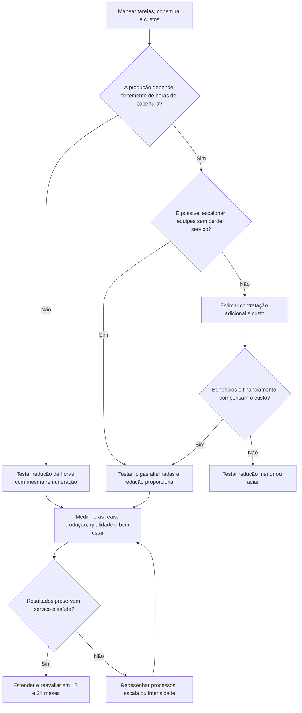
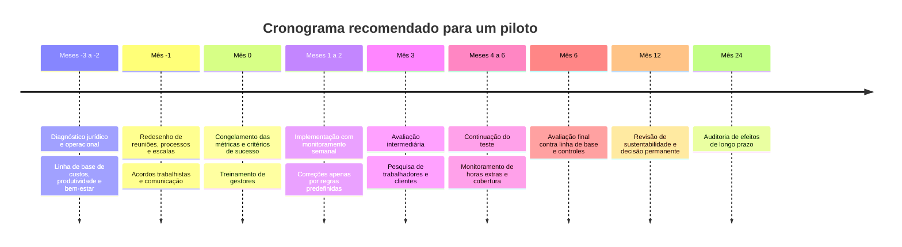

# Semana de quatro dias de trabalho: evidências, desenho institucional e recomendações para empregadores e formuladores de políticas

## Resumo executivo

A expressão “semana de quatro dias” cobre arranjos bastante diferentes e, para avaliar resultados, é essencial não confundi-los. O modelo que concentra a maior parte da evidência recente é a **redução substantiva das horas semanais sem redução do salário**, frequentemente resumida pela fórmula “100–80–100”: 100% da remuneração, cerca de 80% do tempo anterior e compromisso de preservar 100% dos resultados relevantes. Ele difere da **semana comprimida**, na qual as mesmas 40 horas, por exemplo, são distribuídas em quatro jornadas de dez horas; da **alternância ou escalonamento**, em que equipes folgam em dias diferentes para manter atendimento; e de um **piloto**, que é uma experiência temporária, mensurada e reversível antes de eventual adoção permanente. O piloto oficial português explicitamente adotou redução de horas, manutenção salarial, voluntariedade e reversibilidade, permitindo que cada organização negociasse formatos como 32, 34 ou 36 horas [5].

A evidência mais forte disponível até 2026 favorece a hipótese de que uma redução bem desenhada pode melhorar significativamente o bem-estar sem deteriorar necessariamente o desempenho organizacional. Um estudo publicado em *Nature Human Behaviour* em 2025 analisou 2.896 trabalhadores de 141 organizações em seis países após reorganização do trabalho e seis meses de semana reduzida; burnout, satisfação no trabalho, saúde mental e saúde física melhoraram, enquanto o mesmo padrão não apareceu em 12 empresas de controle. Reduções maiores nas horas efetivamente trabalhadas no nível individual estiveram associadas a ganhos maiores de bem-estar, mediados parcialmente por menor fadiga e problemas de sono e por melhor percepção da capacidade de trabalho [1].

Isso, porém, **não equivale a provar que toda empresa pode eliminar 20% das horas e manter automaticamente 100% da produção**. Os principais pilotos são formados por organizações voluntárias, muitas vezes pequenas e intensivas em conhecimento; há pouca randomização, heterogeneidade de métricas e horizonte predominantemente de seis meses. No grande piloto britânico de 2022, por exemplo, 61 organizações e cerca de 2.900 empregados participaram, mas 66% das empresas tinham no máximo 25 funcionários e marketing, serviços profissionais e organizações sem fins lucrativos estavam fortemente representados [2]. A receita permaneceu praticamente estável entre início e fim do teste — alta média ponderada de 1,4% nas 23 empresas com dados suficientes — e foi 34,5% maior que no período comparável anterior entre outras 24; os próprios autores alertam que condições econômicas externas impedem interpretação causal simples desse segundo número [2].

Os resultados sobre saúde e retenção são mais consistentes que os de produtividade financeira. No piloto britânico, 39% dos empregados relataram menos estresse e 71% menos burnout; as demissões voluntárias caíram de 2 para 0,8 por 100 empregados e as ausências por doença ou motivos pessoais de 2,0 para 0,7 dia por empregado/mês, embora os pesquisadores ressaltem que essas últimas diferenças não alcançaram segurança estatística suficiente em razão da pequena amostra empresarial e de fatores do mercado de trabalho [2]. Além disso, a redução real foi menor que o slogan “32 horas”: a média passou de 38 para 34 horas e parte das pessoas continuou realizando algum trabalho no suposto dia livre [2].

Portugal e Brasil reforçam a plausibilidade, mas também ilustram os limites de generalização. Em Portugal, 41 empresas privadas e mais de mil trabalhadores participaram do teste de 2023; as horas declaradas pelas empresas caíram, em média, de 39,3 para 34 por semana. A proporção de trabalhadores que considerava difícil ou muito difícil conciliar trabalho e vida pessoal caiu de 46% para 8%, e os indicadores reportados mostraram reduções de 19% em exaustão, 21% em ansiedade, 23% em fadiga e 19% em problemas de sono [3][4]. O programa foi voluntário, reversível e não ofereceu subsídio salarial às empresas; o Estado forneceu suporte técnico e administrativo [4][5].

No Brasil, um piloto privado iniciado em 2024 teve 21 empresas inicialmente, das quais 19 completaram os seis meses, abrangendo 252 trabalhadores no final; a média reportada de horas caiu de 42,8 para 36,5 por semana e 97,5% dos respondentes declararam forte desejo de continuidade [7]. As empresas estavam concentradas em serviços — tecnologia, comunicação, consultoria, contabilidade, design, entre outros — embora a amostra incluísse também saúde [7]. Como o estudo foi voluntário, sem grupo externo de controle e com parcela importante de resultados autorreportados, deve ser interpretado como **evidência de viabilidade em organizações pioneiras**, não como estimativa causal do efeito para toda a economia brasileira [7].

Para empregadores, a principal conclusão prática é que a semana reduzida deve ser tratada como **redesenho de processo e não como simples cancelamento da sexta-feira**. Para governos, a melhor abordagem não é inferir dos pilotos que uma redução uniforme produzirá o mesmo efeito em todos os setores, mas criar condições para experimentação mensurável, negociação coletiva, proteção contra intensificação do trabalho e avaliação independente. A evidência hoje é suficientemente positiva para justificar testes mais amplos; ainda é insuficiente para calcular com confiança efeitos macroeconômicos de longo prazo sobre salários, preços, emprego, produtividade agregada ou finanças públicas [1][2][3][6][7].

## Definições, modelos e mecanismos econômicos

O primeiro modelo é a **redução de jornada com remuneração semanal preservada**. Uma empresa que passa de 40 para 32 horas mantendo o salário não está apenas mudando o calendário: está elevando aritmeticamente em 25% a remuneração por hora trabalhada. Uma passagem de 40 para 36 horas implica aumento de aproximadamente 11,1% no custo salarial por hora; de 44 para 36, cerca de 22,2%. Se não houver contratação adicional e a empresa precisar manter exatamente o mesmo volume semanal de produção, esses números indicam aproximadamente quanto a produção por hora precisa crescer para que somente a produtividade horária compense a redução. Na prática, o ponto de equilíbrio também pode ser atingido por menor absenteísmo, rotatividade, retrabalho e custos de recrutamento, além de melhorias de processo; por isso “produtividade por hora”, “produção por empregado” e “resultado financeiro” precisam ser avaliados separadamente.

É precisamente por essa razão que o modelo 100–80–100 não significa “produzir freneticamente em quatro dias”. Os pilotos estruturados incluem uma etapa anterior de reorganização: redução e encurtamento de reuniões, agendas mais claras, revisão de comunicações assíncronas, automação, eliminação de tarefas de baixo valor e maior autonomia operacional. No piloto britânico, reuniões mais curtas ou menos frequentes e mudanças nas práticas de comunicação estiveram entre as estratégias empregadas [2]; no estudo internacional posteriormente publicado em *Nature Human Behaviour*, a reorganização do trabalho precedeu formalmente os seis meses de redução [1].

O segundo modelo, a **semana comprimida**, é economicamente distinto: trabalhar quatro vezes dez horas em lugar de cinco vezes oito não reduz o total de 40 horas. Pode diminuir deslocamentos e liberar um dia inteiro, mas não proporciona o mesmo aumento de tempo total de recuperação associado a uma redução de 40 para 32 ou 36 horas. Portanto, não é metodologicamente válido usar estudos de redução de horas como prova de benefícios de um regime 4×10. A distinção também é decisiva juridicamente, especialmente em países com limites de jornada diária.

O terceiro desenho é a **alternância ou escalonamento**. O estabelecimento continua operando cinco, seis ou sete dias, mas diferentes equipes têm dias de folga distintos. O piloto britânico documentou, além do “dia comum de folga”, formatos escalonados, descentralizados, anualizados e condicionais [2]. Esse caminho é particularmente relevante para saúde, comércio, suporte técnico e outros serviços cuja disponibilidade não pode simplesmente cair 20%.

Há ainda formatos intermediários. Em Portugal, 58,8% das empresas ofereciam um dia livre por semana, enquanto 41,5% adotaram uma quinzena de nove dias úteis — uma semana de quatro dias alternada com outra de cinco [4]. A redução média, de 13,7%, mostra por que o debate não deve ser reduzido à escolha binária “cinco dias versus 32 horas”: organizações têm testado gradientes de redução, desde 10% até aproximadamente 20% [4].

Finalmente, **piloto** deve significar mais do que adoção informal temporária. O desenho português previu voluntariedade, reversibilidade, fase preparatória e mensuração dos impactos organizacionais e de saúde [5]; o brasileiro teve três meses de preparação seguidos por seis meses de implementação, com questionários antes, durante e depois e entrevistas qualitativas com dirigentes [7]. Um piloto bem construído produz informação que permite decidir; um “teste” sem linha de base cria sobretudo impressões.

## Evidências sobre produtividade, saúde, bem-estar e distribuição

No campo do bem-estar, a literatura recente avançou consideravelmente. O estudo internacional de Fan, Schor, Kelly e Gu é particularmente importante porque ultrapassa os relatos empresariais: compara resultados antes e depois em 141 organizações e verifica que as melhorias observadas em burnout, satisfação, saúde mental e saúde física não apareceram no conjunto de 12 empresas de controle [1]. O fato de ganhos maiores estarem associados a reduções individuais maiores de horas também fortalece o mecanismo substantivo: não basta renomear a semana; as pessoas precisam realmente trabalhar menos [1].

Ainda assim, o desenho não deve ser confundido com um grande ensaio clínico randomizado. Empresas que procuram programas de semana curta provavelmente diferem das que não procuram: podem ter lideranças mais abertas, trabalhos mais flexíveis, margens mais altas ou problemas específicos de retenção. Controles reduzem algumas ameaças à inferência causal, mas não eliminam automaticamente seleção organizacional, efeitos de expectativa ou diferenças não observadas. Além disso, os dados individuais do estudo ainda não estavam publicamente disponíveis em 2026 por razões de privacidade; os autores indicam intenção de disponibilização posterior após tratamento para reduzir risco de identificação [1].

Os resultados britânicos mostram simultaneamente o potencial e o problema metodológico. Dos 61 empregadores participantes, 56 — 92% — planejavam continuar após o piloto, e 18 já haviam tornado o regime permanente quando o relatório foi preparado [2]. O bem-estar melhorou em múltiplas dimensões, mas métricas empresariais tinham amostras menores: apenas 23 empresas forneceram dados adequados para a comparação de receita entre começo e fim e 24 para comparação com período anterior [2]. A alta de 34,5% versus período histórico, portanto, não deve ser traduzida em “a semana de quatro dias aumenta a receita em 35%”; macroeconomia, crescimento específico das empresas e sazonalidade permanecem explicações concorrentes [2].

A experiência islandesa ajuda a ampliar a diversidade setorial. Dois programas liderados por Reykjavík e pelo governo nacional envolveram, ao longo do tempo, mais de 2.500 trabalhadores, muitos passando de 40 para 35 ou 36 horas sem redução salarial. Os participantes incluíam escritórios, pré-escolas, serviços sociais, hospitais e trabalhadores em escalas não convencionais; o relatório concluiu que produtividade e nível de serviço ficaram estáveis ou melhoraram na maioria dos locais analisados e registrou melhorias em estresse, burnout, saúde e equilíbrio entre trabalho e vida [6]. Posteriormente, negociações coletivas concederam a grande parte da força de trabalho islandesa redução efetiva ou direito de negociar horas menores [6]. Como o relatório é produzido por entidades favoráveis à redução da jornada e sintetiza experiências públicas não randomizadas, seus resultados também devem ser lidos com essa limitação em mente [6].

A evidência por **tamanho de empresa** permanece especialmente incompleta. O piloto britânico demonstra que pequenas organizações conseguem implementar a mudança — 29% dos participantes tinham de um a dez empregados e 37% tinham de 11 a 25 —, mas isso não prova que os efeitos sejam iguais por porte [2]. Microempresas podem reorganizar decisões mais rapidamente, mas também têm menos redundância para cobrir ausências; grandes corporações têm maior capacidade de redistribuir equipes, mas enfrentam custos de coordenação e maior heterogeneidade ocupacional. Não há, nos principais estudos examinados, evidência causal suficientemente robusta para afirmar que determinado porte obtém sistematicamente retorno maior [2][1].

A situação é semelhante por **setor**. Trabalho de conhecimento apresenta oportunidades óbvias de eliminar reuniões e interrupções; produção industrial, hospitais, varejo e logística têm uma componente de cobertura física que não desaparece com automação de escritório. A Islândia mostra que redução é possível inclusive em serviços presenciais e turnos [6], e o piloto britânico incluiu saúde, manufatura e construção [2], mas as maiores categorias britânicas continuaram sendo marketing, serviços profissionais e entidades sem fins lucrativos [2]. O conjunto de evidências não autoriza afirmar que uma fábrica, um hospital e uma empresa de software enfrentarão a mesma função de custos.

Há também uma questão distributiva importante. Uma política disponível apenas para profissionais de escritório pode ampliar a diferença de qualidade do emprego entre ocupações de alta autonomia e trabalhadores de atendimento contínuo. O desenho mais equitativo não é necessariamente “todos folgam na sexta”, mas **todos obtêm uma redução proporcional e mensurável de tempo**, com escalas distintas conforme a operação. Para trabalhadores de meio período, o benefício também deve ser pensado em horas, e não apenas em “ganhar um quinto dia”, sob risco de excluir justamente quem já possui jornadas diferenciadas.

## Custos, retorno econômico e diferenças entre empresas

O custo central para o empregador não é misterioso: mantém-se a folha semanal enquanto caem as horas contratadas. Em empresas nas quais produção depende quase linearmente de tempo de cobertura — uma linha industrial operando em determinado número de postos, um hospital que precisa de determinada relação entre profissionais e pacientes ou atendimento presencial aberto por muitas horas — pode ser necessária contratação, pagamento adicional ou reorganização de turnos. Nesses casos, a semana reduzida tem um custo fiscal ou empresarial real que não deve ser disfarçado por ganhos vagos de “engajamento”.

Em organizações com muita perda de tempo organizacional, a equação pode ser diferente. Se parte relevante das 40 horas era absorvida por reuniões, espera, retrabalho, burocracia ou comunicação redundante, reduzir a disponibilidade pode forçar a remoção dessas ineficiências. O piloto britânico mostrou receita praticamente estável entre início e fim apesar da queda média das horas de 38 para 34; paralelamente, registrou sinais favoráveis em rotatividade e absenteísmo, embora estes últimos não fossem estatisticamente conclusivos [2]. Isso é compatível com a hipótese de compensação parcial por produtividade e custos indiretos menores, mas não mede o retorno financeiro líquido de cada organização [2].

Do ponto de vista do trabalhador, manter o salário enquanto se reduz a jornada representa aumento do salário por hora e maior disponibilidade de tempo. O efeito sobre renda monetária é neutro por construção, mas custos de deslocamento podem cair quando há menos dias presenciais. A consequência para cuidado de crianças ou familiares depende da arquitetura concreta: um dia inteiro livre tende a ser mais útil para algumas famílias, enquanto quatro jornadas mais longas podem aumentar a necessidade de cobertura no começo ou fim do dia. Por isso, redução e compressão não devem ser tratadas como substitutos perfeitos.

Para pequenas empresas, os custos fixos de diagnóstico, assessoria jurídica, redesenho de processos e coleta de dados podem ser proporcionalmente maiores. Políticas públicas podem, portanto, financiar **assistência técnica, treinamento, digitalização e avaliação**, em vez de assumir indefinidamente a folha salarial. Portugal fornece um precedente instrutivo: o Estado estruturou apoio técnico e administrativo, mas o piloto não ofereceu contrapartida financeira direta às empresas [5]. Isso reduz risco fiscal e testa se o modelo se sustenta economicamente por si mesmo [5].

Para programas públicos maiores, subsídios temporários podem fazer sentido quando o objetivo explícito é produzir evidência em setores em que a contratação adicional é inevitável, mas deveriam estar condicionados a dados auditáveis e ter prazo de término. Caso contrário, um resultado aparentemente positivo pode refletir apenas a transferência do custo do empregador para o contribuinte.

No plano macroeconômico, a incerteza é muito maior. Reduções generalizadas poderiam elevar demanda por mão de obra em setores dependentes de cobertura; poderiam também pressionar custos, estimular automação ou levar algumas organizações a aceitar menor horário de atendimento. O resultado sobre emprego, preços, investimento e salários dependeria da produtividade marginal, da concorrência e da capacidade de repassar custos. Os pilotos organizacionais existentes não foram concebidos para identificar esses efeitos de equilíbrio geral [1][2][3][6].

## Marco jurídico, negociação coletiva e particularidades do Brasil, UE e Reino Unido

No Brasil, a Constituição estabelece, como regra geral, duração normal não superior a oito horas diárias e 44 semanais, permitindo compensação e redução mediante acordo ou convenção coletiva; também protege a irredutibilidade salarial, salvo negociação coletiva, reconhece convenções e acordos coletivos e garante repouso semanal remunerado [8].

A CLT acrescenta detalhes relevantes. O artigo 59 admite, na disciplina geral, acréscimo de até duas horas extraordinárias por dia e prevê modalidades de compensação e banco de horas; a legislação contém regimes excepcionais específicos, como 12×36. A CLT exige ainda intervalo mínimo de 11 horas consecutivas entre jornadas e repouso semanal de 24 horas, enquanto o artigo 611-A prevê prevalência da negociação coletiva em determinados temas de jornada, respeitados limites constitucionais [9].

Isso gera uma consequência prática importante. Uma empresa brasileira pode reduzir contratualmente ou coletivamente o total semanal e preservar salários, desde que observe o arcabouço aplicável. Já **comprimir automaticamente 44 horas em quatro jornadas de 11 horas não deve ser presumido legalmente equivalente a uma simples mudança de escala**, porque supera a estrutura ordinária de oito horas mais até duas adicionais do artigo 59; situações específicas exigem exame do regime legal, convenção coletiva e categoria profissional [8][9]. Uma semana de 40 horas comprimida em quatro jornadas de dez também requer estruturação jurídica apropriada de compensação. Essas conclusões são aplicações do marco geral, não parecer jurídico para casos individuais.

O tema continua objeto de disputa de política pública no Brasil. Em 2025 e 2026, propostas de redução constitucional da jornada para 36 horas e ampliação do repouso semanal foram discutidas no Congresso; em audiência na Câmara em maio de 2026, representantes empresariais defenderam que eventual redução fosse implementada prioritariamente por negociação coletiva, evidenciando que a escolha entre mudança constitucional uniforme e solução negociada permanece controvertida [12][13].

Na União Europeia, a Diretiva 2003/88/CE estabelece um piso supranacional de proteção, não uma semana de quatro dias: os Estados devem assegurar ao menos 11 horas consecutivas de descanso diário, descanso semanal de 24 horas acrescido do descanso diário e limite médio de 48 horas semanais incluindo horas extras, sujeito às regras e derrogações previstas [10]. A adoção de quatro dias continua, portanto, dependente da legislação nacional, contratos e negociação coletiva [10].

A Islândia ilustra particularmente bem o papel sindical. Após os testes públicos, sindicatos e confederações negociaram entre 2019 e 2021 reduções de jornada ou direitos de redução para grandes parcelas da força de trabalho, demonstrando uma trajetória “piloto → avaliação → negociação coletiva”, em vez de uma simples imposição organizacional instantânea [6].

No Reino Unido, todos os empregados têm direito legal a **solicitar** trabalho flexível desde o primeiro dia, incluindo mudanças no número de horas, dias, horários ou local de trabalho; o empregador deve tratar o pedido razoavelmente, mas pode recusá-lo por razões empresariais reconhecidas. Isso não constitui um direito automático a uma semana de quatro dias com salário integral [11].

## Avaliação, riscos e lacunas de pesquisa

Uma implantação séria começa pela escolha do contrafactual: “o que teria acontecido sem a mudança?”. O mínimo recomendável é uma linha de base de oito a doze semanas e comparação com período equivalente do ano anterior. Melhor ainda é manter departamentos ou unidades comparáveis como controles e introduzir a mudança de forma escalonada. Em organizações suficientemente grandes, um desenho de implementação por etapas — *stepped wedge* — permite que todos eventualmente participem, mas cria períodos comparáveis entre grupos. O piloto britânico coletou receita, emprego, demissões, admissões, ausências e indicadores dos trabalhadores, além de comparar vários resultados com um período equivalente anterior [2].

A medição deve separar quatro dimensões. A primeira é **tempo real trabalhado**: horas registradas, trabalho no “dia livre”, horas extras e mensagens fora do expediente. Isso é indispensável porque, no Reino Unido, 15% dos respondentes relataram aumento de horas e a média final ainda era 34, não 32 [2]. A segunda é **produção e qualidade**: entregas, receita ou margem por trabalhador, produção por hora, cumprimento de prazos, erros, retrabalho, reclamações e nível de serviço. A terceira é **capital humano**: absenteísmo, rotatividade, tempo para preencher vagas e desligamentos. A quarta é **saúde e sustentabilidade**, com instrumentos consistentes de burnout, estresse, sono, satisfação e equilíbrio trabalho-vida [1][2].

O maior risco comportamental é a **intensificação do trabalho**: retirar horas formalmente, mas exigir a mesma quantidade de tarefas sem eliminar atividades pode gerar dias excessivamente densos ou trabalho clandestino na folga. A mitigação é medir horas reais, limitar disponibilidade no dia livre, proteger pausas e acompanhar fadiga junto com produtividade. Se a produção sobe à custa de deterioração de saúde seis meses depois, o experimento falhou mesmo que o trimestre financeiro pareça bom.

O segundo risco é a **perda de serviço ao cliente**. A mitigação é escalonar folgas e definir níveis mínimos de cobertura. O terceiro é a **desigualdade interna**, quando profissionais administrativos ganham redução e equipes operacionais não; uma solução é definir o direito em termos de percentual de redução de horas, permitindo formatos distintos. O quarto é o **efeito novidade**: entusiasmo inicial pode não sobreviver a dois anos. Daí a necessidade de avaliações em seis, doze e 24 meses.

O quinto risco é analítico: medir “produtividade” de maneira que garanta o resultado desejado. Receita total pode aumentar porque o mercado cresceu; produção por hora pode subir mesmo com produção semanal menor; satisfação pode melhorar sem viabilidade financeira. Antes do piloto, empresa e trabalhadores deveriam definir conjuntamente quais variáveis representam sucesso e quais são guardrails — por exemplo, não aumentar acidentes, reclamações ou horas extras acima de determinado limite.

As maiores lacunas atuais são de longo prazo e de validade externa. Faltam grandes estudos randomizados envolvendo empresas industriais, varejo, logística, saúde 24/7 e trabalhadores de menor renda; faltam comparações causais por porte empresarial; faltam análises de cinco ou dez anos sobre carreira, promoção e investimento; e faltam estudos macroeconômicos que estimem efeitos em preços e emprego. A literatura recente fortalece bastante a conclusão sobre bem-estar, mas é menos definitiva sobre produtividade financeira universal [1][2][3][6][7].

## Implementação e monitoramento

Para uma empresa, o caminho mais defensável é começar pela pergunta econômica, não pelo calendário. Deve-se mapear quais atividades dependem de tempo de cobertura, quais dependem de entrega e quais são desperdício organizacional. Equipes cujo produto é projeto ou conhecimento podem experimentar uma redução próxima de 20%; áreas de atendimento contínuo podem precisar começar com 10% a 15%, escalonar dias ou ampliar quadro. O objetivo inicial é encontrar o máximo de redução de horas que preserve qualidade, segurança e sustentabilidade financeira.

O seguinte fluxo resume uma decisão prudente:

Antes do teste, liderança e trabalhadores deveriam estabelecer uma hipótese verificável: por exemplo, reduzir a jornada de 40 para 34 ou 36 horas sem queda superior a determinada margem em produção semanal, mantendo qualidade e sem aumento de horas extras. A experiência portuguesa mostra por que flexibilidade é útil: empresas escolheram diferentes reduções e formatos em vez de receber uma arquitetura única [4][5].

Um cronograma de aproximadamente nove meses — semelhante, em espírito, às fases preparatórias utilizadas no Brasil e em Portugal — permite distinguir preparação de experimento propriamente dito [5][7].

Para formuladores de políticas, a prioridade deveria ser construir **infraestrutura de experimentação**. Governos podem financiar assistência técnica e sistemas de mensuração, facilitar modelos de negociação coletiva, selecionar amostras deliberadamente diversas e exigir avaliação independente. Em vez de medir apenas satisfação, pilotos públicos deveriam publicar horas reais, output por hora, output por trabalhador, custos de pessoal, contratações adicionais, horas extras, qualidade de serviço, rotatividade, absenteísmo e indicadores de saúde.

É especialmente importante incluir hospitais, indústria, varejo, logística, escolas, pequenos municípios e microempresas, porque são precisamente os contextos menos representados nos pilotos empresariais voluntários. Também seria recomendável sortear a ordem de entrada das unidades sempre que politicamente e operacionalmente possível; isso melhora muito a identificação causal sem privar permanentemente nenhum grupo do programa.

A recomendação final, portanto, não é “adotar quatro dias em toda parte” nem “rejeitar porque não funciona em todos os setores”. O estado da evidência sustenta uma posição intermediária mais forte: **reduções reais de tempo de trabalho, com remuneração preservada e acompanhadas de redesenho organizacional, apresentam evidência consistente de melhoria de bem-estar e evidência promissora — porém mais heterogênea — de manutenção do desempenho** [1][2][3][6]. O benefício parece depender de as horas efetivamente caírem, de se remover trabalho de baixo valor e de a operação ser redesenhada; simplesmente comprimir a mesma carga em quatro dias não reproduz automaticamente esses mecanismos [1][5].

Para empregadores, isso justifica pilotos cuidadosamente controlados, não fé em slogans. Para governos, justifica experimentação, negociação coletiva e produção de evidência setorial antes de universalizações rígidas. O teste decisivo não é se o calendário tem quatro ou cinco dias, mas se **menos horas reais conseguem produzir trabalho economicamente sustentável, serviços adequados e vidas melhores sem transferir custos ocultos para trabalhadores, consumidores ou contribuintes**.

## Referências

[1] Fan, Wen; Schor, Juliet B.; Kelly, Orla; Gu, Guolin. **“Work time reduction via a 4-day workweek finds improvements in workers’ well-being.” Nature Human Behaviour, 2025.**  
https://www.nature.com/articles/s41562-025-02259-6

[2] Autonomy; University of Cambridge; Boston College. **“The Results Are In: The UK’s Four-Day Week Pilot.” 2023.**  
https://autonomy.work/wp-content/uploads/2023/02/The-results-are-in-The-UKs-four-day-week-pilot.pdf

[3] PLANAPP — Centro de Competências de Planeamento, de Políticas e de Prospetiva da Administração Pública. **“Avaliação do Projeto-Piloto Semana de Quatro Dias.” 2024.**  
https://www.planapp.gov.pt/estudos-avaliacao/avaliacao-do-projeto-piloto-semana-de-quatro-dias/

[4] Governo de Portugal. **“95% das empresas avaliam positivamente experiência da Semana de Quatro Dias.” 2023.**  
https://portugal.gov.pt/gc23/comunicacao/noticias/95-das-empresas-avaliam-positivamente-experiencia-da-semana-de-quatro-dias

[5] Instituto do Emprego e Formação Profissional — IEFP / Governo de Portugal. **“Experiência-Piloto Semana de Quatro Dias.”**  
https://www.iefp.pt/documents/10181/11729755/Experiencia-Piloto_Semana%2Bde%2Bquatro%2Bdias.pdf/f4cdc63f-1023-4e1b-89c3-e35e8a7a06ea

[6] Haraldsson, Guðmundur D.; Kellam, Jack. Autonomy e Alda. **“Going Public: Iceland’s Journey to a Shorter Working Week.” 2021.**  
https://autonomy.work/wp-content/uploads/2021/06/ICELAND_4DW.pdf

[7] 4 Day Week Brazil / Reconnect. **“Brazil 4 Day Week Pilot — Final Trial Results.”**  
https://static1.squarespace.com/static/66d46d86bd7db51794e9c3cd/t/693e8a0d0669596b183b27fa/1765706253519/Brazil%2B4%2BDay%2BWeek%2BPilot%2B2024.pdf

[8] Brasil, Presidência da República. **“Constituição da República Federativa do Brasil de 1988”, especialmente art. 7º.**  
https://www.planalto.gov.br/ccivil_03/constituicao/constituicao.htm

[9] Brasil, Presidência da República. **“Decreto-Lei nº 5.452, de 1º de maio de 1943 — Consolidação das Leis do Trabalho”, especialmente arts. 59, 59-A, 66, 67 e 611-A.**  
https://www.planalto.gov.br/ccivil_03/decreto-lei/del5452.htm

[10] União Europeia. **“Directive 2003/88/EC concerning certain aspects of the organisation of working time.”**  
https://eur-lex.europa.eu/legal-content/EN/TXT/?uri=CELEX:32003L0088

[11] Governo do Reino Unido. **“Flexible working.” GOV.UK.**  
https://www.gov.uk/flexible-working

[12] Câmara dos Deputados. **“Empregadores propõem negociação coletiva para reduzir jornada para 36 horas em vez de mudar a Constituição.” 2026.**  
https://www.camara.leg.br/noticias/1273660-empregadores-propoem-negociacao-coletiva-para-reduzir-jornada-para-36-horas-em-vez-de-mudar-a-constituicao/

[13] Senado Federal. **“Jornada de 36 horas trará empregos e qualidade de vida, dizem debatedores.” 2025.**  
https://www12.senado.leg.br/noticias/materias/2025/04/08/jornada-de-36-horas-trara-empregos-e-qualidade-de-vida-dizem-debatedores