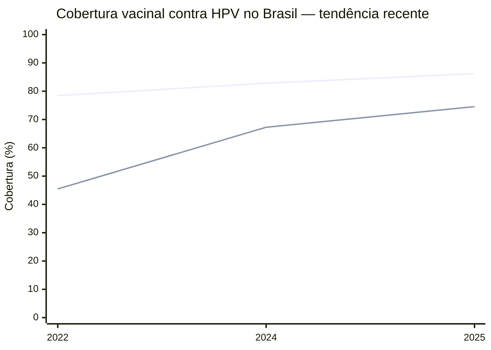

# Vacinação contra HPV e câncer do colo do útero

## Resumo executivo

A vacinação contra o papilomavírus humano (HPV) constitui uma das intervenções de prevenção primária do câncer com evidência mais consistente disponível atualmente: a infecção persistente por tipos oncogênicos de HPV é a causa necessária de praticamente todos os cânceres do colo do útero, além de participar da etiologia de cânceres de ânus, vulva, vagina, pênis e orofaringe.[24][25] Em 2024, estimaram-se aproximadamente 604 mil novos casos de câncer cervical e cerca de 280 mil mortes no mundo, com carga desproporcional em populações que têm menor acesso à vacinação, ao rastreamento e ao tratamento.[24]

Existem três gerações principais de vacinas profiláticas contra HPV: a bivalente, dirigida aos tipos oncogênicos 16 e 18; a quadrivalente, que acrescenta os tipos 6 e 11, relacionados sobretudo às verrugas anogenitais; e a nonavalente, que inclui ainda os tipos oncogênicos 31, 33, 45, 52 e 58.[6][7][11] Todas utilizam partículas semelhantes ao vírus, ou *virus-like particles* (VLPs), formadas pela proteína L1 do capsídeo, capazes de induzir títulos elevados de anticorpos neutralizantes sem causar infecção, porque não contêm vírus HPV infeccioso.[6][7] Elas são profiláticas: impedem novas infecções, mas não eliminam infecção por HPV ou lesões que já estejam estabelecidas.[5]

Nos ensaios que fundamentaram seu desenvolvimento, a vacina bivalente apresentou proteção muito elevada contra infecção persistente por HPV16/18 em mulheres previamente não infectadas; a quadrivalente atingiu eficácia de aproximadamente 98% contra o desfecho combinado de neoplasia intraepitelial cervical de alto grau, adenocarcinoma *in situ* ou câncer relacionado a HPV16/18 na população suscetível do estudo FUTURE II; e a nonavalente apresentou eficácia de 96,7% contra doença cervical, vulvar e vaginal de alto grau causada conjuntamente pelos cinco tipos adicionais 31/33/45/52/58, preservando resposta imunológica contra 6/11/16/18.[8][10][11] Esses valores não significam que cada genótipo tenha exatamente a mesma eficácia individual, porque vários ensaios foram desenhados para desfechos agrupados por conjuntos de tipos virais.[10][11]

A evidência já ultrapassou os desfechos intermediários: revisões sistemáticas mostram quedas substanciais da circulação de HPV vacinal e de lesões CIN2+, estudos nacionais demonstram redução de câncer cervical invasivo, e dados ingleses publicados em 2026 forneceram a primeira evidência nacional robusta de forte queda de mortalidade associada à vacinação.[13][14][16][17] Na Inglaterra, entre 2020 e 2024, não ocorreu nenhuma morte por câncer cervical entre mulheres de 20–24 anos de uma coorte cuja cobertura aos 12–13 anos havia sido de aproximadamente 88–90%, enquanto 23,1 mortes seriam esperadas com base nas tendências históricas; os autores estimaram cerca de 200 mortes evitadas até o fim de 2024.[17] Por ser um estudo observacional populacional, esse resultado deve ser interpretado como uma associação de grande magnitude e elevada plausibilidade causal, e não como um ensaio randomizado de mortalidade.[17]

No Brasil, a vacina quadrivalente foi incorporada ao Programa Nacional de Imunizações em 2014 e, desde 2024, o esquema rotineiro para meninas e meninos de 9 a 14 anos imunocompetentes passou a ser de dose única.[1] Em 2026 permanece vigente, até 31 de dezembro, uma estratégia de resgate oferecendo uma dose aos jovens de 15 a 19 anos sem vacinação prévia ou sem registro vacinal.[2] Imunocomprometidos de 9 a 45 anos, incluindo pessoas vivendo com HIV/aids e determinados pacientes oncológicos, transplantados ou com imunodeficiências, continuam requerendo três doses, tipicamente em 0, 2 e 6 meses no esquema brasileiro.[3]

A conclusão de política pública é clara: os maiores ganhos marginais no Brasil provavelmente virão menos da discussão abstrata sobre a eficácia biológica da vacina — hoje muito bem estabelecida — e mais da capacidade de transformar disponibilidade em cobertura homogênea, especialmente entre meninos, adolescentes não alcançados, populações vulneráveis e municípios de baixa cobertura.[1][18][19] A vacinação em escolas, sistemas ativos de busca e resgate, recomendação inequívoca por profissionais de saúde, inclusão de meninos, esquemas simplificados e integração com rastreamento cervical são complementares, e não estratégias concorrentes.[1][23][25]

## Fundamentos, evolução das vacinas e mecanismo de proteção

O desenvolvimento das vacinas contra HPV mudou a prevenção do câncer do colo do útero de uma estratégia historicamente concentrada em detectar lesões precursoras para uma combinação de prevenção primária por vacinação e prevenção secundária por rastreamento.[23][25] Os primeiros ensaios da vacina bivalente contra HPV16/18 foram publicados no início dos anos 2000, mostrando elevada imunogenicidade e proteção contra infecção incidente e persistente em mulheres jovens.[8] A geração quadrivalente acrescentou HPV6 e HPV11 aos oncogênicos 16 e 18 e tornou possível prevenir simultaneamente grande parte das doenças relacionadas aos tipos oncogênicos cobertos e das verrugas anogenitais causadas pelos tipos 6/11.[10] A nonavalente posteriormente estendeu a cobertura para HPV31, 33, 45, 52 e 58, genótipos de alto risco responsáveis por parcela adicional importante das neoplasias cervicais.[6][11]

A bivalente, comercialmente associada ao Cervarix, contém VLPs de L1 dos tipos HPV16 e 18 e utiliza um sistema adjuvante destinado a intensificar a resposta imune.[7] A quadrivalente contém VLPs de HPV6, 11, 16 e 18.[10] A nonavalente, Gardasil 9, conserva esses quatro componentes e acrescenta VLPs de HPV31, 33, 45, 52 e 58.[6] O fato de serem VLPs é fundamental para seu perfil biológico: a estrutura externa imita o capsídeo viral e é reconhecida pelo sistema imune, mas não há genoma viral capaz de produzir uma infecção pelo HPV.[6][7]

O principal efeito protetor decorre da produção de anticorpos neutralizantes que alcançam o epitélio e bloqueiam etapas iniciais da infecção quando partículas virais entram em contato com microlesões da mucosa.[6][7] Como a vacina age antes do estabelecimento da infecção persistente, sua eficácia é maximizada quando administrada antes da exposição sexual ao HPV, fundamento para concentrar programas nacionais na pré-adolescência ou no início da adolescência.[4][5] A mesma lógica explica por que vacinar uma pessoa sexualmente ativa ainda pode oferecer benefício contra tipos aos quais ela não tenha sido exposta, mas não funciona como tratamento das infecções existentes.[5]

O ensaio inicial da bivalente encontrou eficácia de 91,6% contra infecção incidente e de 100% contra infecção persistente por HPV16/18 na análise por protocolo, embora intervalos de confiança e número de eventos devam ser considerados ao interpretar valores próximos de 100%.[8] No estudo PATRICIA, a eficácia contra CIN2+ associada a HPV16/18 foi de aproximadamente 92,9% na análise principal da população suscetível e aumentou quando se aplicaram métodos de atribuição causal da lesão ao tipo viral relevante.[9]

No FUTURE II, envolvendo mais de 12 mil mulheres, a quadrivalente teve eficácia de aproximadamente 98% contra lesões cervicais de alto grau ou câncer relacionados a HPV16/18 entre participantes sem evidência prévia de infecção pelos tipos relevantes.[10] Quando eram incluídas mulheres independentemente de exposição prévia, a eficácia era substancialmente menor, uma demonstração experimental de por que o momento da vacinação é tão importante.[10]

No ensaio pivotal da nonavalente, com mais de 14 mil mulheres, a eficácia contra doença cervical, vulvar ou vaginal de alto grau associada conjuntamente aos tipos HPV31/33/45/52/58 foi de 96,7% na população suscetível, ao mesmo tempo em que as respostas contra HPV6/11/16/18 foram não inferiores às produzidas pela quadrivalente.[11] Assim, a vantagem fundamental da nonavalente não é “uma vacina mais forte” contra HPV16/18, mas uma ampliação da quantidade de genótipos oncogênicos diretamente cobertos.[6][11]

## Esquemas de doses, segurança e recomendações oficiais

As recomendações de dose precisam ser lidas no contexto de cada autoridade, porque OMS, Ministério da Saúde brasileiro, CDC e registros regulatórios da EMA não cumprem exatamente a mesma função.[1][4][5][6] A OMS recomenda que a vacinação seja priorizada antes da exposição ao HPV e admite esquemas de uma ou duas doses para meninas de 9–14 anos e para mulheres jovens de 15–20 anos; para mulheres com mais de 21 anos, sua posição de 2022 prevê duas doses com aproximadamente seis meses de intervalo.[4] Para pessoas imunocomprometidas, incluindo pessoas vivendo com HIV, a OMS recomenda pelo menos duas doses e, quando possível, três, porque a evidência que sustentou a simplificação para dose única é bem mais limitada nesses grupos.[4]

No Brasil, a Nota Técnica nº 41/2024 adotou **uma dose da vacina HPV quadrivalente para meninas e meninos de 9 a 14 anos imunocompetentes**, substituindo o esquema rotineiro anterior de múltiplas doses.[1] A decisão foi baseada na recomendação internacional e em estudos que encontraram eficácia e imunogenicidade persistentes depois de uma única dose, além do potencial de aumentar cobertura e reduzir barreiras logísticas.[1] A mesma nota recomendou estratégia de resgate de adolescentes não vacinados até 19 anos e destacou explicitamente a vacinação em escolas como componente fundamental para alcançar altas coberturas.[1]

Em 2026, o resgate brasileiro de jovens de **15 a 19 anos não vacinados** foi prorrogado até 31 de dezembro de 2026, com oferta gratuita de uma dose pelo SUS.[2] Para pessoas de 9 a 45 anos com condições imunocomprometedoras contempladas pelas recomendações brasileiras — como HIV/aids, determinadas situações oncológicas, transplante e imunodeficiências — o esquema permanece de três doses, em 0, 2 e 6 meses.[3] Usuários de PrEP para HIV de 15 a 45 anos não previamente vacinados também estão entre os grupos para os quais a SBIm registra indicação de três doses no contexto das normas brasileiras atuais.[3]

Nos Estados Unidos, o CDC recomenda vacinação rotineira aos 11–12 anos, podendo começar aos 9 anos, e *catch-up* para todas as pessoas até 26 anos que não foram adequadamente vacinadas.[5] Quem inicia antes dos 15 anos recebe duas doses separadas por 6–12 meses; quem inicia aos 15 anos ou mais dentro da faixa de recomendação recebe três doses em 0, 1–2 e 6 meses, assim como imunocomprometidos de 9–26 anos.[5] Entre 27 e 45 anos, a vacinação não é universalmente recomendada pelo CDC, mas pode ser escolhida mediante decisão clínica compartilhada, porque o benefício populacional médio é menor à medida que aumenta a probabilidade de exposição prévia.[5]

A EMA, por sua vez, avalia qualidade, segurança, eficácia e autorização dos produtos na União Europeia, e não substitui as políticas nacionais de imunização.[6][7] Gardasil 9 está autorizado a partir dos 9 anos e contém os nove genótipos mencionados, enquanto Cervarix é direcionada aos tipos 16 e 18; os esquemas descritos nas informações regulatórias variam conforme idade e produto.[6][7] Portanto, não se deve converter automaticamente a bula europeia, o calendário norte-americano ou a posição da OMS em um esquema brasileiro: no SUS, deve-se seguir a norma vigente do PNI para a condição clínica e a idade da pessoa.[1][3]

Quanto à segurança, as reações mais frequentes são locais — dor, edema ou eritema no local da aplicação — acompanhadas ocasionalmente de sintomas sistêmicos transitórios como cefaleia ou febre.[5] Síncope após injeções ocorre principalmente em adolescentes e não é específica da vacina HPV, razão pela qual o CDC orienta que a pessoa permaneça sentada ou deitada e seja observada por aproximadamente 15 minutos após a vacinação.[5]

A revisão do Comitê Consultivo Global sobre Segurança de Vacinas da OMS identificou anafilaxia como evento raro, estimado em aproximadamente 1,7 caso por milhão de doses em dados analisados, e não encontrou evidência de relação causal entre a vacinação contra HPV e síndromes como Guillain-Barré, síndrome de taquicardia postural ortostática, síndrome de dor regional complexa ou insuficiência ovariana primária.[12] Revisões de ensaios randomizados também não encontraram aumento significativo de eventos adversos graves em comparação com controles.[13]

História de anafilaxia a componente da vacina constitui contraindicação à dose correspondente, e doença aguda moderada ou grave é motivo usual para adiamento temporário.[5] O CDC não recomenda iniciar ou continuar rotineiramente o esquema durante a gravidez, mas a vacinação inadvertida na gestação não constitui indicação de intervenção específica; as doses restantes são postergadas.[5] Esses dados diferenciam uma precaução programática de uma evidência de que a vacina cause dano reprodutivo, associação que grandes avaliações de segurança não demonstraram.[5][12][13]

## Eficácia no mundo real, câncer e mortalidade

A transição de ensaios clínicos para programas nacionais confirmou que a eficácia biológica se traduz em efeito populacional.[14] A meta-análise de Drolet e colaboradores, publicada no *Lancet* em 2019 e abrangendo dezenas de milhões de pessoas, encontrou, após cinco a oito anos de programas de vacinação, redução de aproximadamente 83% na prevalência de HPV16/18 entre meninas de 13–19 anos e de 66% entre mulheres de 20–24 anos.[14] No mesmo conjunto de evidências, CIN2+ caiu cerca de 51% entre meninas de 15–19 anos e 31% entre mulheres de 20–24 anos, ao mesmo tempo em que foram detectados efeitos indiretos de imunidade de grupo em populações não vacinadas.[14]

Nos Estados Unidos, o CDC relata que, depois da introdução da vacinação, as infecções pelos tipos vacinais caíram 88% entre adolescentes do sexo feminino e 81% entre mulheres adultas jovens, enquanto a proporção de lesões cervicais pré-cancerosas atribuíveis aos tipos cobertos diminuiu aproximadamente 40% entre mulheres vacinadas.[15] O seguimento disponível naquele programa também não mostrou evidência de perda relevante de proteção durante aproximadamente 12 anos após a vacinação.[15]

A Cochrane, analisando ensaios de vacinas profiláticas, concluiu haver evidência de alta certeza de proteção contra pré-câncer cervical em adolescentes e mulheres jovens, com efeito mais intenso quando a vacinação ocorre antes de infecção por HPV de alto risco.[13] Essa distinção é importante: um programa de vacinação adolescente é biologicamente diferente de uma estratégia de vacinar pessoas muito mais velhas já expostas a múltiplos genótipos, mesmo que ambas utilizem o mesmo imunizante.[5][13]

Os dados mais recentes também respondem à antiga questão sobre duração da proteção contra doença invasiva.[16] Uma extensão de acompanhamento nacional sueco publicada no *BMJ* em 2026 encontrou proteção sustentada contra câncer cervical invasivo durante até 18 anos após vacinação quadrivalente, sem evidência de redução progressiva do efeito ao longo do período estudado.[16] As coortes alcançadas por vacinação escolar tiveram incidência ajustada de câncer cervical aproximadamente 72% menor que a coorte vacinada oportunisticamente, reforçando a importância de vacinar cedo e de forma organizada.[16]

No Brasil, estudo populacional publicado em 2026 na *npj Vaccines* comparou inquéritos nacionais realizados em 2016–2017 e 2020–2023 entre pessoas sexualmente ativas de 16–25 anos e documentou redução populacional da prevalência dos genótipos cobertos pela vacina quadrivalente.[18] O estudo também não encontrou diferença significativa na redução de prevalência segundo o número de doses declarado, observação consistente com a política de simplificação para dose única, embora um estudo transversal repetido não possa substituir seguimento randomizado de décadas em todos os subgrupos clínicos.[18] Trata-se de evidência particularmente relevante porque dados de efetividade populacional oriundos de países de renda média são menos abundantes que os provenientes de Europa, América do Norte e Austrália.[18]

A mortalidade é o desfecho mais tardio e, historicamente, o mais difícil de demonstrar, pois as primeiras adolescentes vacinadas precisaram envelhecer o suficiente para atravessar a sequência exposição ao HPV–persistência viral–lesão precursora–câncer invasivo–óbito.[17] Em 2026, Sasieni e Falcaro analisaram mortalidade cervical inglesa entre 2001 e 2024 e encontraram que, entre mulheres de 20–24 anos em 2020–2024, não ocorreu nenhuma morte onde 23,1 seriam esperadas pelas tendências históricas, correspondendo a redução estimada de 100%, com intervalo de confiança de 84% a 100%.[17] Entre mulheres de 25–29 anos em 2020–2024, a redução observada foi de aproximadamente 69%, e os autores estimaram cerca de 199,6 mortes evitadas em todas as coortes avaliadas até o final de 2024.[17]

Esses achados constituem um marco, mas não justificam interpretar “100%” como garantia individual absoluta contra morte por câncer cervical.[17] O estudo inglês é observacional, trabalha com tendências populacionais e cobertura por coorte, e as mulheres analisadas ainda são jovens; portanto, a magnitude do impacto na mortalidade ao longo de toda a vida adulta continuará sendo refinada nas próximas décadas.[17] O ponto robusto é a coerência causal entre redução de infecção, queda de pré-câncer, redução subsequente de câncer invasivo e, agora, queda da mortalidade em coortes altamente vacinadas.[13][14][16][17]

## Cobertura, implementação e custo-efetividade

A OMS definiu como condição central para a eliminação do câncer cervical como problema de saúde pública atingir incidência inferior a quatro casos por 100 mil mulheres e adotou as metas “90–70–90”: 90% das meninas completamente vacinadas contra HPV até os 15 anos, 70% das mulheres rastreadas com teste de alto desempenho até os 35 e novamente até os 45 anos, e 90% das mulheres com pré-câncer ou câncer recebendo tratamento adequado.[23] Vacinação e rastreamento, portanto, não são substitutos: mesmo populações altamente vacinadas precisam de prevenção secundária, sobretudo porque nenhuma das vacinas existentes cobre literalmente todos os tipos oncogênicos de HPV e porque mulheres já infectadas antes da vacinação não têm aquela infecção eliminada pelo imunizante.[5][23][25]

A desigualdade de cobertura permanece o principal obstáculo para transformar a eficácia em eliminação global.[21] A revisão mais recente das estimativas WHO/UNICEF disponível em 2026 mantém séries específicas de cobertura contra HPV por país, e os dados referentes a 2024 mostraram melhora global, porém ainda muito aquém da meta de 90%.[21] Relatos da divulgação conjunta WHO/UNICEF estimaram aproximadamente 31% de cobertura entre meninas elegíveis em 2024, comparados a cerca de 17% em 2019.[22]

No Brasil, houve melhora rápida depois da queda de cobertura observada nos anos anteriores: dados divulgados pela UNA-SUS indicaram que a cobertura entre meninas de 9–14 anos passou de 78,42% em 2022 para 82,83% em 2024, enquanto entre meninos aumentou de 45,46% para 67,26%.[19] Dados do PNI reportados em 2026 para 2025 apontaram aproximadamente 86,22% entre meninas e 74,55% entre meninos, embora persistam grandes diferenças territoriais e a cobertura masculina continue inferior à feminina.[27] O painel oficial do Ministério da Saúde permite acompanhar por coorte, sexo e território a cobertura contra HPV e evidencia que a média nacional pode ocultar bolsões locais muito abaixo da meta.[20]

*Primeira linha: meninas; segunda linha: meninos. Valores de 2022 e 2024 divulgados pela UNA-SUS; valores de 2025 reportados em 2026 com base em dados do PNI.[19][27] Como os dois conjuntos foram divulgados por fontes diferentes, o gráfico deve ser interpretado como tendência programática, não como reconstrução microestatística de uma única base longitudinal.*

O Ministério da Saúde já identificava entre os obstáculos internacionais e nacionais restrições financeiras, problemas de disponibilidade, dificuldades logísticas e desigualdades de acesso, e sua Nota Técnica de 2024 ressaltou que a vacinação em escolas é fundamental para aumentar cobertura no grupo de 9–14 anos.[1] Evidências brasileiras mais recentes também indicam diferenças persistentes entre sexos e unidades federativas, enquanto desinformação, hesitação de famílias e profissionais e associação equivocada da vacina à iniciação sexual aparecem como barreiras comportamentais relevantes.[27]

Campanhas escolares têm uma vantagem estrutural: levam o serviço ao local em que se concentra a população-alvo, em vez de depender de que cada família procure espontaneamente uma unidade de saúde.[1] O achado sueco de proteção mais forte em coortes alcançadas por programas escolares e a experiência inglesa de cobertura próxima a 90% nas primeiras coortes reforçam a associação entre vacinação precoce, programas organizados e maior impacto posterior sobre câncer e mortalidade.[16][17]

A vacinação de meninos deve ser entendida tanto como prevenção individual quanto populacional, porque HPV causa doenças e cânceres também no sexo masculino e porque reduzir a circulação viral amplia a proteção indireta da comunidade.[14][25] A decisão brasileira de usar uma estratégia universal de meninas e meninos de 9–14 anos também reduz a dependência de uma cobertura feminina perfeita para produzir imunidade populacional.[1][14]

O *catch-up* tem maior rendimento quando alcança adolescentes e adultos jovens ainda próximos da idade de vacinação de rotina, antes de uma extensa exposição aos tipos virais.[5][13] A prorrogação brasileira para não vacinados de 15–19 anos até dezembro de 2026 é, assim, uma janela operacional importante para recuperar coortes perdidas durante anos de cobertura insuficiente e durante as perturbações recentes dos programas de vacinação.[2]

A vacinação contra HPV também tem perfil econômico favorável em modelos brasileiros, embora resultados antigos não devam ser tratados como preços atuais.[26] Um modelo dinâmico publicado para o Brasil estimou razões incrementais de custo-efetividade de aproximadamente R$350 por QALY ganho para vacinação rotineira de meninas e R$720 por QALY para estratégia incluindo *catch-up*, sob os preços, custos, estrutura epidemiológica e hipóteses disponíveis no momento do estudo.[26] No mesmo modelo, rotina mais *catch-up* poderiam evitar, ao longo de 50 anos, cerca de 163 mil casos de câncer cervical e 48 mil mortes; são projeções contrafactuais, e não contagens observadas no SUS.[26]

A simplificação para dose única tende a melhorar ainda mais a eficiência programática porque reduz necessidade de retornos, custo de aplicação, perdas de seguimento e demanda logística, desde que a proteção permaneça suficientemente durável.[1][4] Essa é justamente a razão pela qual a política de dose única é particularmente atraente para populações imunocompetentes jovens, enquanto a mesma simplificação não deve ser automaticamente extrapolada para imunocomprometidos, para os quais a base empírica ainda é menor.[1][4]

## Lacunas, recomendações práticas e implicações para políticas públicas

A primeira lacuna importante é a duração da proteção de **uma única dose** ao longo de várias décadas e especificamente contra câncer invasivo, já que os dados mais longos de câncer ainda derivam predominantemente de coortes que receberam esquemas utilizados antes da adoção ampla da dose única.[1][16] Os dados disponíveis de infecção e imunogenicidade são suficientemente fortes para fundamentar a posição da OMS e a política brasileira em jovens imunocompetentes, mas ainda são necessários seguimentos de longo prazo que comparem diretamente uma, duas e três doses quanto a câncer invasivo.[1][4]

A segunda lacuna é a população imunocomprometida: há menos evidência sobre dose única em pessoas vivendo com HIV, transplantados, pacientes oncológicos e outras condições que alteram a resposta imune, razão pela qual essas populações continuam recebendo esquemas multidose.[1][3][4] Abandonar doses adicionais nesses grupos sem evidência específica confundiria simplificação operacional com equivalência biológica demonstrada.[3][4]

A terceira é a generalização geográfica dos resultados de câncer e mortalidade: os dados mais maduros vêm de países com registros nacionais robustos, altas coberturas e sistemas organizados de rastreamento, enquanto Brasil e outros países de renda média ainda acumulam seguimento de longo prazo.[16][17][18] O estudo brasileiro de prevalência publicado em 2026 é um avanço importante, mas ainda será necessário conectar essa queda de infecção, ao longo do tempo, a reduções nacionais de CIN3, câncer invasivo e mortalidade, idealmente estratificadas por região, raça/cor, nível socioeconômico e acesso aos serviços.[18]

Também é necessário acompanhar eventual mudança na distribuição de genótipos de HPV depois de décadas de pressão vacinal, quantificar melhor a proteção cruzada contra tipos não incluídos e comparar o benefício incremental da vacina nonavalente em relação à quadrivalente em contextos nos quais custos de aquisição e cobertura populacional competem pelo mesmo orçamento.[6][18] Até o momento, a evidência de enorme redução dos tipos vacinais não fornece base para relaxar a vigilância virológica e epidemiológica.[18]

Para profissionais de saúde, a intervenção de maior valor prático é identificar ativamente a situação vacinal em todo contato elegível, recomendar a vacina de maneira clara e não condicional e explicar que ela previne câncer, não trata HPV já adquirido e produz maior benefício antes da exposição sexual.[5] Deve-se evitar transformar a conversa em julgamento sobre atividade sexual do adolescente, porque o objetivo da vacinação aos 9–14 anos é justamente imunizar antes do período de maior risco de exposição.[1][5] Para imunocomprometidos, usuários de PrEP e demais grupos especiais, é essencial verificar o esquema específico vigente em vez de aplicar automaticamente a regra da dose única da população geral.[1][3]

Para gestores, a prioridade deveria ser combinar vacinação escolar periódica com oferta contínua nas unidades de saúde, busca ativa dos faltosos, *catch-up* das coortes perdidas e monitoramento territorial em granularidade suficiente para identificar municípios e grupos muito abaixo da média nacional.[1][20] A diferença persistente entre meninos e meninas justifica ações explicitamente dirigidas ao sexo masculino, incluindo comunicação de que HPV também causa doença em homens e de que a vacina não é exclusivamente uma intervenção de saúde ginecológica.[19][25][27]

Por fim, a política de eliminação não pode ser reduzida à vacinação isoladamente.[23] A OMS considera necessários simultaneamente alta cobertura vacinal, rastreamento cervical de alto desempenho e tratamento oportuno das lesões precursoras e dos cânceres diagnosticados.[23][24] Mesmo numa geração altamente vacinada, o rastreamento permanecerá necessário por muitos anos porque existem mulheres não vacinadas, infecções adquiridas antes da imunização e tipos oncogênicos que não estão contidos nas vacinas utilizadas.[5][23]

O conjunto da evidência permite uma conclusão analítica forte: para adolescentes imunocompetentes vacinados antes de exposição significativa, o benefício da vacinação contra HPV é grande, durável e já mensurável desde a redução da infecção até a redução de câncer e mortalidade.[13][14][16][17] A questão central para o Brasil em 2026 é menos saber **se** a vacina funciona e mais assegurar que a proteção chegue cedo, de forma homogênea e sustentável a todas as populações elegíveis, preservando esquemas reforçados para imunocomprometidos e mantendo o rastreamento das pessoas com colo do útero.[1][3][23] Nesse sentido, vacinação escolar, dose única para a população geral elegível, vacinação de meninos, resgate até 19 anos, comunicação contra desinformação, vigilância territorial e integração com a prevenção secundária formam uma estratégia coerente com a meta de tornar o câncer do colo do útero uma doença rara e, em última instância, eliminável como problema de saúde pública.[1][2][23]

## Referências

[1] **Ministério da Saúde. Nota Técnica nº 41/2024-CGICI/DPNI/SVSA/MS — Atualização das recomendações da vacinação contra HPV no Brasil.**  
https://www.gov.br/saude/pt-br/centrais-de-conteudo/publicacoes/notas-tecnicas/2024/nota-tecnica-no-41-2024-cgici-dpni-svsa-ms

[2] **Governo Federal. Vacinação contra o HPV para jovens de 15 a 19 anos é prorrogada até dezembro.**  
https://www.gov.br/mulheres/pt-br/central-de-conteudos/noticias/2026/defeso-eleitoral/vacinacao-contra-o-hpv-para-jovens-de-15-a-19-anos-e-prorrogada-ate-dezembro

[3] **Sociedade Brasileira de Imunizações — Vacina HPV4.**  
https://familia.sbim.org.br/vacinas/vacinas-disponiveis/vacina-hpv4

[4] **World Health Organization. Human papillomavirus vaccines: WHO position paper, December 2022.**  
https://www.who.int/publications/i/item/who-wer9750-645-672

[5] **Centers for Disease Control and Prevention. HPV Vaccination Recommendations — Vaccination Considerations for Clinicians.**  
https://www.cdc.gov/hpv/hcp/vaccination-considerations/index.html

[6] **European Medicines Agency. Gardasil 9 — EPAR.**  
https://www.ema.europa.eu/en/medicines/human/EPAR/gardasil-9

[7] **European Medicines Agency. Cervarix — EPAR.**  
https://www.ema.europa.eu/en/medicines/human/EPAR/cervarix

[8] **Harper DM et al. Efficacy of a bivalent L1 virus-like particle vaccine in prevention of infection with human papillomavirus types 16 and 18 in young women: a randomised controlled trial.**  
https://pubmed.ncbi.nlm.nih.gov/15541448/

[9] **Paavonen J et al. Efficacy of human papillomavirus 16/18 AS04-adjuvanted vaccine against cervical infection and precancer caused by oncogenic HPV types: PATRICIA trial.**  
https://www.thelancet.com/journals/lancet/article/PIIS0140673609612484/abstract

[10] **FUTURE II Study Group. Quadrivalent vaccine against human papillomavirus to prevent high-grade cervical lesions.**  
https://pubmed.ncbi.nlm.nih.gov/17494925/

[11] **Joura EA et al. A 9-valent HPV vaccine against infection and intraepithelial neoplasia in women.**  
https://pubmed.ncbi.nlm.nih.gov/25693011/

[12] **World Health Organization, Global Advisory Committee on Vaccine Safety. Human papillomavirus vaccines: safety.**  
https://www.who.int/groups/global-advisory-committee-on-vaccine-safety/topics/human-papillomavirus-vaccines/safety

[13] **Arbyn M et al. Prophylactic vaccination against human papillomaviruses to prevent cervical cancer and its precursors — Cochrane Review.**  
https://pubmed.ncbi.nlm.nih.gov/29740819/

[14] **Drolet M et al. Population-level impact and herd effects following the introduction of human papillomavirus vaccination programmes: updated systematic review and meta-analysis. The Lancet, 2019.**  
https://www.thelancet.com/journals/lancet/article/PIIS0140-6736%2819%2930298-3/abstract

[15] **Centers for Disease Control and Prevention. HPV Vaccination: Impact of HPV Vaccination.**  
https://www.cdc.gov/hpv/vaccines/index.html

[16] **Wu S et al. Extended follow-up of invasive cervical cancer risk after quadrivalent HPV vaccination: nationwide, register based study. The BMJ, 2026.**  
https://www.bmj.com/content/392/bmj-2025-087326

[17] **Sasieni P, Falcaro M. Cervical cancer mortality trends following HPV vaccination in England, 2001–24: an analysis of population-based mortality data. The Lancet, 2026.**  
https://pubmed.ncbi.nlm.nih.gov/42309117/

[18] **Wendland EM et al. Population-level impact of quadrivalent HPV vaccination in Brazil: a repeated cross-sectional study. npj Vaccines, 2026.**  
https://www.nature.com/articles/s41541-026-01495-9

[19] **UNA-SUS. Brasil avança na vacinação contra HPV e supera média global.**  
https://www.unasus.gov.br/noticia/brasil-avanca-na-vacinacao-contra-hpv-e-supera-media-global

[20] **Ministério da Saúde. Vacinação HPV — Coortes vacinais: papilomavírus humano.**  
https://infoms.saude.gov.br/extensions/SEIDIGI_DEMAS_VACINACAO_HPV/SEIDIGI_DEMAS_VACINACAO_HPV.html

[21] **World Health Organization. WHO/UNICEF estimates of national immunization coverage — HPV vaccine coverage estimates.**  
https://www.who.int/teams/immunization-vaccines-and-biologicals/Immunization-data-and-decision-making/global-monitoring/immunization-coverage/who-unicef-estimates-of-national-immunization-coverage

[22] **Reuters. Global childhood vaccination shows slight improvement but challenges remain — WHO/UNICEF 2024 coverage estimates.**  
https://www.reuters.com/business/healthcare-pharmaceuticals/global-childhood-vaccination-shows-slight-improvement-challenges-remain-2025-07-15/

[23] **World Health Organization. Cervical Cancer Elimination Initiative — Global strategy and 90–70–90 targets.**  
https://www.who.int/initiatives/cervical-cancer-elimination-initiative

[24] **World Health Organization. Cervical cancer — Fact sheet.**  
https://www.who.int/news-room/fact-sheets/detail/cervical-cancer

[25] **World Health Organization. Human papillomavirus and cancer.**  
https://www.who.int/news-room/fact-sheets/detail/human-papilloma-virus-and-cancer

[26] **Kawai K et al. Estimated health and economic impact of quadrivalent HPV vaccination in Brazil using a transmission dynamic model. BMC Infectious Diseases.**  
https://link.springer.com/article/10.1186/1471-2334-12-250

[27] **Folha de S.Paulo. Desigualdade na cobertura vacinal contra HPV deixa jovens desprotegidos, 2026.**  
https://www1.folha.uol.com.br/equilibrioesaude/2026/09/desigualdade-na-cobertura-vacinal-contra-hpv-deixa-jovens-desprotegidos.shtml